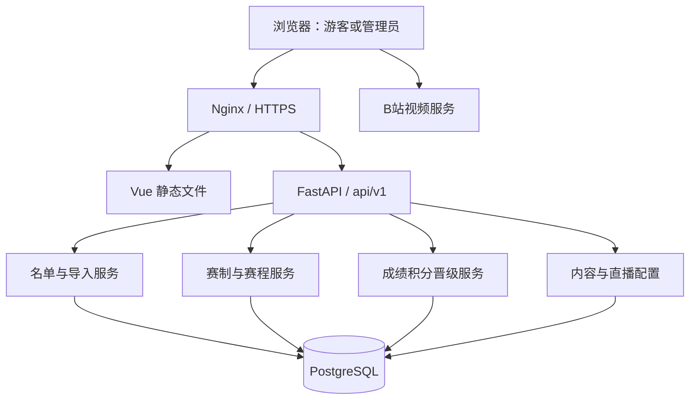

# 技术架构、数据库与接口

版本：V1.1｜2026-11-08｜以下为实施设计，字段类型和 API 在开发时通过迁移及 OpenAPI 固化。

## 1. 架构与工程组织

采用模块化单体：Vue 3 + TypeScript + Vue Router；公开页面使用原稿自定义 CSS，后台使用 Element Plus；FastAPI + SQLAlchemy + Alembic + PostgreSQL；Nginx + Docker Compose，生产主机沿用 Ubuntu 24.04 方向。

公开前台和管理后台位于同一前端工程，分布局、按路由懒加载。管理路由守卫只负责体验，真正权限由 API 校验。前后端通过同一域名 `/api/v1/` 访问，开发环境由前端代理转发。生产前端构建为静态资源；无需生产 Node 服务。



初期不引入 Redis、消息队列、微服务、Kubernetes。导入与赛程生成按此规模可同步执行；预览状态保存数据库，不依赖进程内存。公开比分先用轮询：比赛进行中建议每 30 秒，页面不可见时暂停，恢复可见时刷新。轮询间隔是实施默认，不能宣传为游戏实时数据。

建议结构：

```text
frontend/src/
  layouts/          # PublicLayout、AdminLayout
  pages/public/     # 首页、赛程、战队、比赛、公告、直播
  pages/admin/      # 登录、赛事、名单、导入、分组、录分
  components/       # 品牌、比分、地图、积分、赛程行
  api/              # 类型化请求，不包含业务胜负计算
  styles/           # 基准 tokens、公开前台样式、后台隔离样式
backend/app/
  api/public/       # 仅公开读取
  api/admin/        # 鉴权后管理
  models/           # 数据关系及约束
  schemas/          # 请求、公开响应、管理响应分离
  services/         # roster、imports、tournaments、results
  core/             # 配置、会话、安全、文件校验
backend/migrations/ # Alembic
nginx/              # 反向代理、静态缓存、上传限制
```

## 2. 核心数据模型

业务主键建议 UUID，外部可见队伍编号独立保存。Steam ID 永远按字符串处理；时间使用 `timestamptz`；计数和比分用整数。重要关系使用外键，不整套塞进 JSONB。

| 表 | 主要字段与用途 |
| --- | --- |
| admins | singleton_id、username、password_hash、password_changed_at；主键固定 1，CHECK 限制只存在一个管理员 |
| admin_sessions | token_hash、expires_at、revoked_at；存会话令牌哈希，原值仅在 Cookie |
| competitions | id、slug、name、season、status、published_at、team_limit、roster_revision、rules、map_pool |
| teams | id、name、logo_asset_id、description；可跨届复用的队伍实体 |
| players | id、steam_id，唯一；不开放选手账号 |
| registrations | id、competition_id、team_id、team_code、name_snapshot、logo_snapshot、contact、status、roster_version；语义为当届参赛记录，不含审核状态 |
| registration_members | registration_id、roster_version、player_id、nickname_snapshot、role、is_captain；当届名单历史版本 |
| active_member_claims | competition_id、player_id、registration_id；当前有效选手占用，联合唯一 |
| import_batches | id、competition_id、mode、file_hash、preview_payload、roster_revision、expires_at、status、idempotency_key、summary |
| stages | competition_id、type、order、status、config、rules_version；结构化动态参数可用 JSONB |
| groups | stage_id、name、order |
| stage_entries | stage_id、registration_id、group_id、seed；来源为当届参赛记录 |
| schedule_generations | stage_id、revision、input_hash、random_seed、status；草稿生成批次 |
| matches | competition_id、stage_id、group_id、generation_id、round、code、slot_a_entry_id、slot_b_entry_id、status、best_of、scheduled_at、result_type、winner_entry_id、confirmed_at、version |
| match_rosters | match_id、entry_id、roster_version；比赛开始时锁定当场成员版本 |
| match_maps | match_id、map_index、map_name、score_a、score_b、overtime、status、note |
| match_advancements | source_match_id、source_outcome、target_match_id、target_slot；显式晋级边 |
| stage_qualifications | source_group_id、rank、target_stage_id、target_seed／target_match_id、target_slot；小组名次映射 |
| result_revisions | match_id、previous_version、before_payload、after_payload、reason、created_at；结果修正历史 |
| live_streams | competition_id、match_id 可空、provider、room_url、status、replay_url |
| announcements | competition_id、title、body、status、publish_at、pinned |
| assets | id、type、storage_key、mime、size；公开图片与私密导入文件分存储域 |
| audit_logs | action、entity_type、entity_id、actor_id、before／after、reason、created_at；仅管理员读取 |

本轮不增加公开用户表。`registrations` 名称可保留以兼容原 PRD，但界面称“参赛名单”，不保留 pending／approved／rejected 的旧流程。

## 3. 约束与索引

- `UNIQUE(competition_id, team_code)`；同届有效同队参赛记录唯一，撤销重启复用原记录。
- `UNIQUE(competition_id, player_id)` 限定 active_member_claims，阻止同届重复占用。
- `UNIQUE(registration_id, roster_version, player_id)`，每版本至多一个队长；“恰好五正式和一队长”等跨行规则由受锁事务服务校验。
- `UNIQUE(match_id, map_index)`；地图分数非负；BO 限于 1／3／5；A、B 不得同队。
- 同一目标比赛的同一位置仅允许一个有效来源，晋级图不允许环；跨阶段资格映射在发布时检查完整性。
- 比赛列表索引 `(competition_id, scheduled_at)`、`(stage_id, status)`；公告 `(competition_id, status, publish_at)`；日志与批次按赛事及时间查询。
- 删除有关联成绩的阶段、队伍、比赛使用 RESTRICT 或业务拒绝，不级联清空历史。

前端先查询重复只能提升体验，最终唯一性必须由数据库保证。[PostgreSQL 约束说明](https://www.postgresql.org/docs/current/ddl-constraints.html)

## 4. 事务和并发契约

导入确认锁定赛事名单记录，检查 `roster_revision`，生成最终名单后统一释放／重建本批次涉及的占用，再写快照、递增版本、完成批次和审计。不要逐个队伍提交。

成绩确认／修正采用 `expected_version` 乐观检查，并锁定该赛事的成绩修改入口，序列化同一赛事的成绩与晋级变动；一致顺序锁定受影响比赛，避免死锁。事务内写比分、结果、晋级、版本和审计；积分若采用查询聚合则没有独立积分增量可遗漏。下游已进行的冲突返回 409，并列明受影响比赛。

数据库提交成功后再清理公开缓存。请求提交失败不得返回成功；重复幂等请求返回第一次提交结果。[SQLAlchemy 事务参考](https://docs.sqlalchemy.org/en/21/orm/session_transaction.html)

## 5. API 通用约定

前缀 `/api/v1`。成功返回 `data`，列表附分页 `page/page_size/total`；时间采用带偏移的 ISO 8601。错误形态：

```json
{
  "error": {
    "code": "ROSTER_VERSION_CONFLICT",
    "message": "名单已变化，请重新预览导入文件",
    "details": {"competition_id": "uuid"},
    "request_id": "trace-id"
  }
}
```

状态码：400 不合法请求，401 未登录，403 来源／CSRF 等拒绝，404 不存在或未公开，409 版本与业务冲突，413 文件过大，422 字段校验失败，429 频率限制。后端统一异常处理，不把堆栈、数据库信息或令牌返回浏览器。

## 6. 公开读取接口

| 方法与路径 | 内容 |
| --- | --- |
| GET /competitions | 已发布及历史赛事 |
| GET /competitions/{id} | 基本信息、规则、状态 |
| GET /competitions/{id}/home | 首页聚合：品牌配置、阶段、焦点比赛、积分摘要、赛程与公告 |
| GET /competitions/{id}/teams | 当届公开队伍列表 |
| GET /competitions/{id}/teams/{team_id} | 当届队名、成员快照和成绩 |
| GET /teams/{id} | 队伍概览及各届记录，不混合为同一届战绩 |
| GET /competitions/{id}/stages | 公开阶段 |
| GET /stages/{id}/standings | 积分与排名未决标记 |
| GET /stages/{id}/bracket | 对阵节点、显式连接、待定位置、轮空 |
| GET /competitions/{id}/matches | 可按日期、阶段、状态筛选；日期按北京时间解释 |
| GET /matches/{id} | 双方、名单、地图、系列赛结果、公开备注、直播及回放 |
| GET /competitions/{id}/live | 已配置直播及其状态 |
| GET /competitions/{id}/announcements | 已发布且到发布时间的公告 |
| GET /announcements/{id} | 公告详情 |

删除旧 `POST /registrations` 和 `GET /registrations/status`，不保留可绕过管理员的旧接口。公开读取 DTO 使用字段白名单，与管理端 DTO 完全分离。

## 7. 管理接口

| 方法与路径 | 内容 |
| --- | --- |
| POST /admin/auth/login；POST /admin/auth/logout；GET /admin/auth/me | 唯一管理员会话 |
| PUT /admin/auth/password | 当前密码验证后修改，并失效旧会话 |
| GET /admin/dashboard | 管理概览 |
| POST /admin/competitions；PATCH /admin/competitions/{id} | 创建／修改赛事 |
| POST /admin/competitions/{id}/publish；POST .../archive | 发布／归档 |
| GET /admin/competitions/{id}/registrations | 当届私密名单 |
| POST /admin/competitions/{id}/registrations | 手工录入整队与成员 |
| PATCH /admin/registrations/{id}；POST .../withdraw | 修改资料／撤销资格 |
| POST /admin/registrations/{id}/roster-revisions | 锁名单后的受控成员变更 |
| GET /admin/imports/template?version=1 | 下载 Excel 模板 |
| POST /admin/competitions/{id}/imports/preview | multipart 文件、mode → 批次、汇总、错误、差异 |
| POST /admin/imports/{batch_id}/commit | 预览版本、幂等键 → 正式提交 |
| GET /admin/competitions/{id}/imports；GET /admin/imports/{id} | 批次历史与结果 |
| POST /admin/stages；PATCH /admin/stages/{id} | 阶段规则 |
| PUT /admin/stages/{id}/entries | 分组、种子与阶段参赛者 |
| POST /admin/stages/{id}/generate | 生成草稿批次，不直接发布 |
| POST /admin/schedule-generations/{id}/publish | 发布校验后的赛程 |
| PATCH /admin/matches/{id} | 时间、状态、直播关联等安排 |
| PUT /admin/matches/{id}/result | 保存成绩草稿，含 expected_version |
| POST /admin/matches/{id}/result/confirm | 校验并正式确认 |
| POST /admin/matches/{id}/result/revise-preview | 返回修正对下游的影响，不改数据 |
| POST /admin/matches/{id}/result/revise | 带原因、版本提交修正 |
| PUT /admin/stages/{id}/ranking-resolution | 有理由的最终同分裁定 |
| POST／PATCH /admin/live-streams[/{id}] | 直播和回放配置 |
| POST／PATCH /admin/announcements[/{id}] | 内容管理 |
| POST /admin/assets | 校验后的图片上传 |
| GET /admin/audit-logs | 操作记录 |

路径中的缩略 `...` 在正式 OpenAPI 中必须展开；所有业务写接口都需要会话、来源／CSRF 校验。不存在新增其他管理员接口。API 类型在前后端通过 OpenAPI 对齐，不手工维护互相矛盾的枚举。

## 8. 文件、缓存与生产运行

公开图片只允许经验证的 PNG／JPEG／WebP，限制尺寸与体积，重新编码以清理元数据；文件名随机，不能使用上传路径直接落盘。不接收上传 SVG 或任意 HTML。私密导入存储与公开静态资源分离。

哈希静态资源长缓存，HTML 短缓存；公开接口可短时缓存并在修改成功后失效；管理接口、私密数据及会话响应不进入共享缓存。数据库连接池和 API worker 数量按小内存主机测试配置，禁止照抄高并发部署参数。

容器网络只公开 Nginx 端口，数据库不暴露公网；持久化数据库和图片卷。备份包括 PostgreSQL、图片及部署配置，秘密单独受控保存；开发环境与生产环境数据、密钥分离。生产 API 连接数据库失败时健康检查应失败，不伪装正常。
