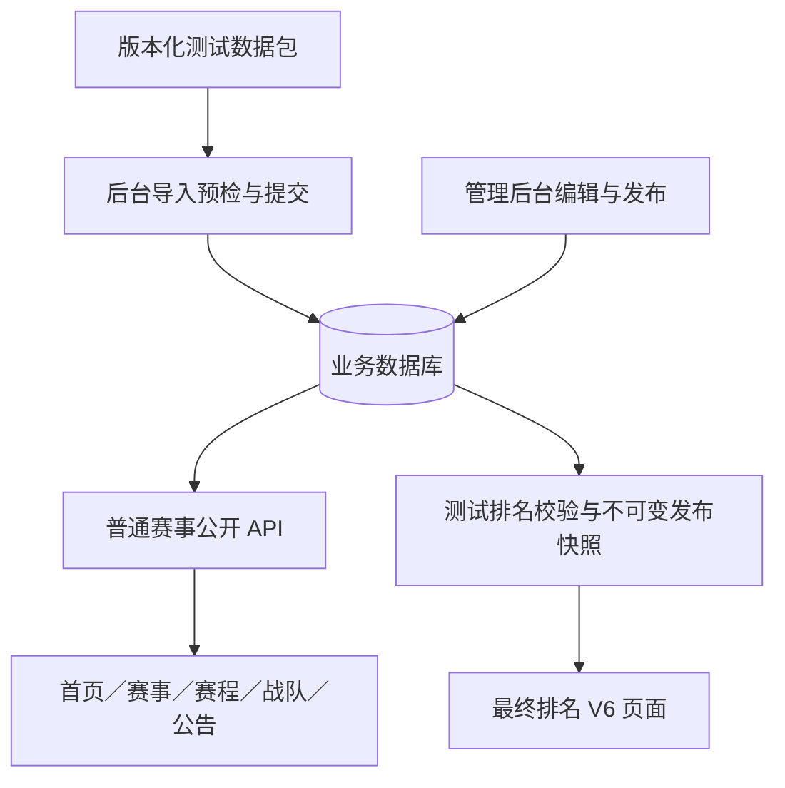

> **开发原则：专注功能开发，减少防御性编程；审查和测试统一放在最后一个环节。**
>
> 开发阶段优先完成本方案要求的功能闭环，复用现有业务能力，减少针对假设场景的额外防御、重复校验、多余兜底和过度抽象。保留必要的业务约束、鉴权、数据一致性和错误处理；不在功能开发阶段穿插代码审查、测试编写或测试执行。全部功能完成后，在最后一个环节集中审查、编写和执行测试、修复问题并验收。

# 示例数据后端化与四队测试排名技术开发方案

版本：V1.1。日期：2026-11-10（Asia/Shanghai）。

**文档状态：方案已整理，尚未开发。本文中的新增表、字段、接口、命令、测试和发布步骤均为后续实施要求，不代表已经存在或执行。此次只新增本文及文档索引，不修改业务代码、配置、数据库、冻结设计或线上环境。**

后续状态补充：用户已授权按本文开发并推送 GitHub，上段为编制方案时的历史状态；实际实现、验证及生产范围见 [16_示例数据后端化开发交付与验证](16_示例数据后端化开发交付与验证_2026-11-10.md)。

## 1. 已确认目标与边界

用户已确认以下要求，优先于旧文档中“默认前端 demo、不写数据库”的交付约定：

1. 公开网页取消“示例数据、前端演示、赛后示例、虚构品牌”等数据性质标注；后台继续清楚标注“示例／测试数据”。
2. 所有当前展示的业务内容转为后端持久化数据，通过管理后台保存、维护和发布，前台读取 API。禁止只隐藏提示后继续依赖前端常量。
3. 保留四支战队，其中原木棉 FIVE 按用户最新要求改名为 `Poppin'Party`，其余为金融风暴、北苑竞技、不加班战队；数量及资料后续可调整，不将系统能力永久限制为四队。
4. 2026 秋季赛在赛事页继续显示“进行中”。最终排名仍属于该届秋季赛，也只保留四队，作为后端测试排名公开展示；不得为了发布排名而自动结束或归档赛事。
5. 最终排名保留当前 V6 示例的视觉样式、冠军纪念章、奖励切换、产品插画、赞助区域、弹窗和动画。
6. 赛事、公告、规则、直播等其他内容尽量保持现状；只移除演示说明，并调整与四队数量、关联完整性直接冲突的内容。
7. 本轮仅编写技术开发文档，不实施开发、导入、迁移、推送或部署。

“保留示例数据样式”解释为保留页面视觉和交互，不保留公开的示例身份文案。版权及素材来源、产品插画说明继续保留，不把它们误判为需要移除的业务数据标注。

## 2. 当前实现核对

本节结论来自当前工作区源码和交付文档，不用于证明线上正在运行的版本。

| 对象 | 当前实现 | 本次必须处理的问题 |
| --- | --- | --- |
| 数据模式 | `Public.vue`、`Results.vue` 默认 `VITE_PUBLIC_DATA_MODE=demo`；Compose 同样默认 demo | 发布版本必须统一读取后端，不能两个页面各自选模式 |
| 普通页面示例 | `redesign/demo.ts` 与 `sample-data.json` | 包含硬编码公告、日期、比分、积分、八队名单及“16队”展示 |
| 最终排名示例 | `results/demo-v6.json`、`demoData()` | 是独立八队赛后场景，ID 不是真实数据库引用 |
| API 页面 | `redesign/data.ts` | 与 demo 的首页标题、赛事封面、日期、分类等表现不同，直接切换不能保持现状 |
| 正式排名 | `final_results.validate()` | 要求赛事 `completed/archived`、实际终局确认及整个最终阶段结束 |
| 排名公开查询 | `final_results.visible()` | 即使写入发布记录，也会过滤进行中的赛事 |
| 冻结发布 | `ResultRelease`、`ResultPage.current_release_id` | 已有版本、幂等、源指纹、撤回、失效机制，应继续复用 |
| 成绩影响 | 普通 `Match/Stage/Advancement` | 会参与积分、晋级、战队比赛记录和排名失效，不能塞入独立赛后测试比分 |
| 名单 | `Registration/Member/RosterSnapshot/Claim` | 每队五名正式成员，名单有版本，联系方式与 Steam ID 不公开 |
| 后台资料保存 | `roster.py`、`content.py`、`final_results.py` | 当前部分写入字段使用白名单；增加字段时须同步模型、校验及写入白名单 |
| HTML 存在性 | `page_checks.py` | `/results/:slug` 通过结果公开函数检查，必须与新可见规则一致 |

既有 `backend/tests/seed_e2e.py` 和 `results_e2e_server.py` 面向独立验收库，不可直接用于此次业务初始化，更不能借用其测试账号和密码。

## 3. 总体架构与数据隔离



采用“后端统一存储、赛程与测试排名来源分离、公开渲染样式统一”的方案：

- 普通赛事、报名名单、赛程及已确认成绩进入现有业务表，继续支持现有赛制和积分功能。
- 独立赛后场景使用新增的测试对局表，关联同届真实数据库战队和结果工作稿，但不写入普通 `Match` 表、不创建晋级边、不影响进行中赛程。
- 名次、奖品、合作关系、奖品分配和发布历史尽量复用现有结果模块。
- 正式排名与测试排名分别校验。仅后台标识为测试的赛事允许测试排名流程；正式赛事的原校验不得整体放宽。
- 前台只请求白名单 API；原冻结示例保留为历史视觉依据和测试夹具，不是运行时数据来源。

特别说明：同一届赛事页“进行中”与排名页“已有四队排名”是本次用户明确要求的测试展示状态。它们共享战队身份，排名页的测试成绩不充当赛事页的正式赛程成绩。

## 4. 数据结构与迁移设计

以下为推荐落地结构。下一迁移暂命名 `004_backend_test_data`；开发开始时核对 Alembic head，若已有新迁移则顺延，禁止覆盖既有迁移。

### 4.1 数据来源与批次

| 表 | 新增字段 | 约束／用途 |
| --- | --- | --- |
| `competitions` | `data_origin VARCHAR(16) NOT NULL DEFAULT 'regular'` | 枚举 `regular/test`；旧记录不自动变为测试 |
| `competitions` | `seed_batch_id` 可空 FK | 追踪本次初始化来源；不与 `published/status` 混用 |
| `sponsors` | `data_origin`、`seed_batch_id` | 品牌是跨赛事实体，不能只从赛事继承身份 |
| `competition_result_pages` | `result_kind VARCHAR(16) NOT NULL DEFAULT 'official'` | `official/test`；保存工作稿配置时不得意外清除 |
| `result_releases` | `result_kind`、`data_origin` | 发布时固化，查询发布版本自身的类型，不用可变工作稿推断历史版本 |
| `seed_batches`（新增） | `id/package_key/package_version/content_sha256/idempotency_key/manifest/created_at` | 唯一幂等键、包键与版本唯一；记录已提交批次及对象清单 |
| `seed_entities`（新增） | `batch_id/entity_type/source_key/entity_id/imported_fingerprint` | `(batch_id,entity_type,source_key)` 唯一；用于定位、重复导入和人工修改检测 |

业务子项如队伍、阶段、比赛、公告、直播、合作方、奖品的有效数据性质从所属赛事派生；后台响应统一附加 `data_origin` 和关联批次信息，避免每个子表维护容易漂移的重复布尔值。对象的精确来源由 `seed_entities` 记录。

`seed_entities.entity_id` 是跨表追踪键，不替代各业务表已有外键；提交时必须验证类型与实体确实匹配。赛事测试身份禁止在普通 PATCH 中随意切换：测试转正式应建立独立正式赛事并录入经核实资料，不通过一键去标完成。

### 4.2 测试排名对局表

新增 `result_test_matches`，专供测试排名场景：

| 字段 | 类型／要求 |
| --- | --- |
| `id` | UUID 字符串主键；公开 DTO 使用可辨识的 `rtm-` 前缀 ID 或明确的类型字段，避免误路由 |
| `competition_id/result_page_id` | 非空；复合外键确保工作稿属于本届 |
| `source_key` | 同一工作稿内唯一，如 `semi-pp-na` |
| `a_registration_id/b_registration_id/winner_registration_id` | 战队 FK，全部同届；双方不同；胜者必须为双方之一 |
| `a_display_version/b_display_version` | 引用对应战队 `RosterSnapshot` 版本，避免随队名修改静默变化 |
| `match_kind` | `semifinal/final/third_place`；后续可扩展，不将数量固定在表结构中 |
| `label/best_of/wins_a/wins_b` | 非空；BO 仍限定 1/3/5，比分须合法并与胜者一致 |
| `maps` | JSON，可空；缺失逐图记录时不得从系列赛比分编造 |
| `maps_status` | `provided/not_provided`；区分无记录与空数组 |
| `champion_path_order` | 可空正整数；同工作稿非空值唯一，只标记冠军经历的对局 |
| `version` | 乐观锁版本；修改时也推进 `ResultPage.version` |

对同一工作稿的 `match_kind=final` 建部分唯一索引，最多一场测试总决赛；测试校验要求恰有一场。SQLite 与 PostgreSQL 均需迁移和约束验证。名次仍使用 `ResultPlacement` 的同届与资料版本 FK；测试路径从本表生成，不向强制关联普通 `Match` 的 `ResultPathMatch` 写入测试 ID。

不增加公开的测试对局详情路由。结果页弹窗从发布快照读取，`detail_url=null`，不得拼接 `/matches/{test-id}`。

### 4.3 普通页面展示信息

为保持现有样式，业务属性与展示属性分开建模：

- 在 `Competition.config.presentation` 中存放受校验的 `hero_title_lines`、`poster_label`、`poster_asset_key`、`starts_on`、`ends_on`、`date_label`、`display_name`。日期使用 ISO 日期；显示短日期由前端统一格式化，特殊文案才使用 `date_label`。
- 封面只允许预设资源枚举，如 `cs2-1/cs2-2/cs2-3`；管理后台提供选择器，不允许提交任意 HTML、CSS 或脚本。
- 公共 `c_dto()` 只增加显式 `presentation` 投影，不直接输出完整 `config`。
- `Announcement` 新增 `category_label`（限制长度，如 100 字）及 `display_order`（默认 0）。同置顶等级按后端约定的顺序和发布时间排序，保留现有三条公告的顺序与分类。
- 若公告后台写接口继续使用字典，必须同步新增字段白名单；优先补充类型化输入模型。赛事 `config` 修改采用完整受控对象或明确的嵌套合并，避免仅保存展示字段时删除赛制配置。
- `team_count` 表示有效参赛队数，`team_limit` 表示可配置容量。公开卡片使用实际数量，后台可调整容量；本次秋季赛初始容量 4，实际队数 4。

### 4.4 迁移兼容性

新增字段对旧记录使用兼容默认值；已有赛事、正式结果和媒体引用保持原值。新迁移只建结构，不自动插入示例数据。数据初始化由单独显式操作完成。回退前若已有测试发布，须先保存备份；不能宣称删表降级可无损恢复新增数据。

## 5. 四队数据包规范

### 5.1 权威来源和包结构

未来新增 `backend/fixtures/public-test-v1.json`，它是经人工整理的后端初始化输入；不是把原文件改名后直接导入。来源逐项记录到 manifest：

1. `frontend/src/redesign/sample-data.json`：赛事目录及原始数据归档。
2. `frontend/src/redesign/demo.ts`：实际展示的公告、日期、规则、派生名单与逐图生成规则。
3. `frontend/src/results/demo-v6.json`：赛后视觉与奖品场景。

当归档 JSON 与实际页面逻辑不一致时，保留当前页面的业务内容，并在 manifest 记录差异；积分这种派生值以合法比赛成绩计算，不复制静态积分表。

数据包顶层包含 `schema_version/package_key/package_version/timezone/competitions/teams/schedule/results/sponsors/partners/prizes/allocations/content_changes`。使用稳定 `source_key` 关联；导入器创建数据库 ID 并统一映射，不能保留原 `demo-team-*` 为真实引用。

### 5.2 战队与成员

| source_key | 中文名 | 编号 | 英文名 | 海报断行 |
| --- | --- | --- | --- | --- |
| `pp` | Poppin'Party | PP | Poppin'Party | Poppin' / Party |
| `fs` | 金融风暴 | FS | FINANCE STORM | FINANCE / STORM |
| `na` | 北苑竞技 | NA | NORTH ARENA | NORTH / ARENA |
| `ot` | 不加班战队 | OT | NO OVERTIME | NO / OVERTIME |

冠军队名严格使用 `Poppin'Party`（ASCII 单引号 U+0027，大小写保持一致），不使用弯引号或 `Poppin‘party`。本次是原冠军队伍的更名，不新增第五队；原示例 `mf/demo-team-mf` 引用在转换时统一映射到 `pp` 对应的同一战队实体。队伍列表、普通赛程、焦点对局、测试名次、冠军路径、冠军纪念章、奖励领取队伍、搜索及离线导出同步使用新名称；徽章缩写使用 PP，英文名使用 Poppin'Party，海报按上表断行。原冻结设计文件保留历史内容，不修改历史基准。

每队五名正式成员、一名队长、初始无替补，共 20 名。保留当前显示昵称；第三、四队派生昵称在数据包中展开为确定值，禁止运行时按数组序号随机生成。初始名单生成 `RosterSnapshot v1`，比赛绑定对应版本。

现有名单校验要求联系方式及 17 位 Steam ID。测试包使用固定、互不重复、满足现有格式校验的合成占位值及“内部测试占位”联系方式，不收集真实个人信息，不视为已验证 Steam 账号。公开 DTO、页面、离线导出、导入报告均不得泄露这些私密字段。原测试数据包仅供内部维护，不能放进前端 public 目录。

### 5.3 普通赛事、赛程和积分

- 保留三张赛事卡：2026 秋季赛、2026 春季赛、2025 秋季赛，名称、年份、日期、封面与状态文案保持现状。
- 秋季赛 `published=true/is_default=true/status=ongoing/data_origin=test`。
- 春季赛采用已结束状态，2025 秋季赛采用归档状态，均标记测试数据。原示例未提供历史赛果，不复制秋季赛赛果填充历史赛事，也不凭空生成历史名单。它们的实际参赛数展示为空／待补充，不继续显示没有实体支持的 16 队。
- 秋季赛按一组四队单循环、前二晋级决赛整理，保留现有四场已结束、两场待开始的小组对局及日期和系列赛比分；通过原生成、发布、成绩确认服务建立，不手工破坏晋级关系。
- 已完成比赛逐图数据可按旧 demo 明示的派生规则固化为测试数据；须在 manifest 标注“旧演示规则生成”，并验证逐图胜场与系列赛比分相符。
- 全部时间以带时区 ISO 8601 保存，显示统一 Asia/Shanghai。禁止为使首页出现比赛而继续固定“当前时间”为 2026-11-09；未来自然进入已过去或下一比赛日状态。
- 焦点对局通过 `focus_match_id` 指定 Poppin'Party 对金融风暴一场，保留原对局时间与成绩，仅同步冠军队的新名称和展示资料。
- 小组积分按已确认比赛计算。旧静态积分表与已有对局不完全一致，允许此处因数据正确性变化，记录前后差异。
- 公开规则保留原赛制与地图池，移除“示例规则”等说明；与四队容量直接相关的 16／8 队描述调整。未提供的组织方等必填字段采用现有项目的中性组织方默认值，并在后台标明待核实，不能捏造真实机构授权。

### 5.4 测试排名及独立测试对局

固定初始名次为：Poppin'Party 第一、金融风暴第二、北苑竞技第三、不加班战队第四。全部引用秋季赛四队数据库实体；后台明确它们是独立测试排名，不是由进行中的小组成绩算出的最终结果。

推荐初始化对局如下。后两项补充用于使四队赛后测试场景完整，属于本方案的技术默认数据，须在导入预览显式列出，不宣称来自原示例：

| 对局 | BO | 比分 | 数据来源 | 冠军之路 |
| --- | --- | --- | --- | --- |
| 半决赛：Poppin'Party vs 北苑竞技 | 3 | 2:1 | 保留 V6 原半决赛成绩，同步队名 | 第 1 项 |
| 总决赛：Poppin'Party vs 金融风暴 | 5 | 3:1 | 保留 V6 原总决赛及四张逐图记录，同步队名 | 第 2 项 |
| 半决赛：金融风暴 vs 不加班战队 | 3 | 2:0 | 新增合成测试对局；无逐图记录 | 否 |
| 季军赛：北苑竞技 vs 不加班战队 | 3 | 2:0 | 新增合成测试对局；无逐图记录 | 否 |

移除原四分之一决赛（对手五排事务所已不在四队内）。半决赛原本没有逐图记录，继续保留缺失状态；弹窗展示“暂无逐图成绩”。测试排名可根据这套完整独立对局核验冠亚季军，不给正式排名添加无依据的手工排序豁免。

### 5.5 奖励、赞助和公告

保留五个品牌／合作方、四类奖品与内置插画：核境 NEXCORE（首席）、帧界 FRAME、沸点 FIZZ、联序 LINKUP、回响 REPLAY；H1 耳机、K75 键盘、M4 鼠标、纪念徽章。

| 名次 | 外设 | 纪念徽章 |
| --- | --- | --- |
| 第一 | H1 耳机 5 副 | 5 枚 |
| 第二 | K75 键盘 5 把 | 5 枚 |
| 第三 | M4 鼠标 5 只 | 5 枚 |
| 第四 | 无 | 5 枚 |

总外设 15 件，总徽章 20 枚，按分配记录聚合，不能写死。赞助商简介去除“设计设定、示例赛事”等身份提示，保留支持内容；无官网则保持空值，不编造链接。受信任内置图形继续使用 `nexcore/headset/keyboard/mouse` 枚举，不开放任意 SVG 输入。

三条公告保留标题、发布时间、分类和主要内容，移除正文中的“本页为前端设计演示”“本页展示的是虚构队伍”等句子。“本预览以……为示例”改为直接陈述本届规则。把逐条原文、修改后文案和理由列入 `content_changes`，避免借转换数据之机重写公告。

原本暂无有效直播／回放的状态继续保留为空；不制造可点击的假房间或假回放。

## 6. 接口与管理后台

所有下列路径均以 `/api/v1` 为前缀。后台继续使用现有单管理员会话、Origin 和 CSRF 校验。

### 6.1 既有接口扩展

| 接口 | 调整 |
| --- | --- |
| `GET /competitions`、`GET /competitions/{key}` | 增加白名单 `presentation`、实际队数，保留既有字段兼容 |
| `GET /competitions/{key}/home` | 实际队数、焦点、积分和日期全部使用后端数据 |
| 公告公开查询 | 采用显式 DTO，输出分类和排序字段，不直接扩散新增内部来源信息 |
| `GET /admin/competitions` 等后台读取 | 返回有效 `data_origin` 和批次信息；支持按来源筛选 |
| `PUT /admin/competitions/{key}/final-results/draft` | 明确 `result_kind`；类型只能在无公开版本且无冲突数据时初始化／转换，转换应撤回旧版并清理不兼容引用 |
| 最终排名 `/preview /validate /publish /withdraw /releases` | 保留现有路径，服务端根据已存储的 `result_kind` 选择策略；不能信任请求中的绕过开关 |
| `GET /results/latest`、`/results/editions`、`/competitions/{key}/results` | 使用第 7 节统一可见规则，支持进行中测试赛事的测试发布 |

数据性质不是前端权限：前台是否显示标注与后端是否允许测试发布完全分离。公开 DTO 可含机器可读的 `release.kind=test` 与 `match.source_kind=result_test`，不渲染成游客标签。批次、合成身份、内部原因等仅后台可见。

### 6.2 新增测试对局接口

| 方法与路径 | 行为 |
| --- | --- |
| `GET /admin/competitions/{key}/final-results/test-matches` | 返回本工作稿测试对局、版本及后台测试标识 |
| `PUT /admin/competitions/{key}/final-results/test-matches` | 整批保存对局及路径顺序，携带 `expected_version`；成功推进工作稿版本 |

保存须核验赛事 `data_origin=test`、工作稿 `result_kind=test`，执行同届／版本／比分校验，失败整批回滚。不得通过这个接口写普通 `Match`。正式模式调用返回 422 `TEST_MODE_REQUIRED`。版本冲突为 409 `VERSION`，跨届引用为 422 `CROSS_COMPETITION`。

### 6.3 初始化导入接口

新增后台入口“测试数据初始化”：

- `POST /admin/test-data-imports/preview`：选择服务端内置包键与版本；返回包哈希、计划变更、冲突、数量、补充测试对局、文案差异和短期预览令牌。禁止从浏览器提交任意服务器文件路径。
- `POST /admin/test-data-imports/{preview_id}/commit`：提交令牌、包哈希及 `Idempotency-Key`，事务内再次校验实际状态；成功返回批次和对象映射，失败整体回滚。
- `GET /admin/test-data-imports/{batch_id}`：查询批次摘要和提交结果，不返回成员私密数据。

预览可使用专用短期预览表／现有批次模式实现，但不能冒用只支持队伍 Excel 的 `ImportBatch` 格式。预览令牌绑定包哈希、库状态指纹和过期时间；状态变化返回 409 `IMPORT_STALE`。相同已提交幂等键及相同输入返回原结果，键相同但输入不同返回 409。

导入不新增管理员，不读取或覆盖管理密码。若未来提供 CLI，只能作为同一服务的包装，默认 dry-run，不能维护另一套直接写库逻辑。当前 CLI 仅有账号初始化／重置，本方案未创建新命令。

### 6.4 后台界面细节

- 赛事列表、选择器、赛事编辑页显示“示例／测试数据”，普通子页继承该标识。
- 战队、赛程、公告、合作方、奖品在当前测试赛事上下文持续显示标识；品牌库按品牌自身来源显示。
- 最终排名页同时显示“赛事状态：进行中”“排名类型：测试排名”“当前公开版本：测试版本 N”。
- 测试模式隐藏实际最终阶段选择，改为测试对局编辑；候选计算只使用测试对局，不调用正式终局推导。
- 发布按钮显示“发布测试排名”，校验成功提示“可发布测试排名”；正式模式继续使用现有正式发布文字与规则。
- 预览、发布历史、撤回与重新发布继续复用，修改工作稿不会立即覆盖已公开快照。

## 7. 两类排名校验、发布与可见性

### 7.1 校验策略

将当前逻辑拆成共同校验与来源策略，避免在 `validate()` 中增加一个直接 `return success` 的测试分支。

共同校验：全部有效队伍覆盖、名次连续且无重复、唯一冠军、战队同届、名单版本存在、领取人数匹配、奖品分配与数量正确、提供方有效、图片来源合法、公开字段白名单。

正式策略保留原要求：赛事已结束／归档，实际终局已确认，最终阶段比赛已公开且确认，冠亚季军、路径与正式成绩一致。

测试策略要求：

1. `Competition.data_origin=test`、`ResultPage.result_kind=test`，赛事已发布；允许 `ongoing/completed/archived`，不允许草稿、未发布赛事。
2. 测试对局全部属于该工作稿和本届队伍；初始四队场景有两场半决赛、一场决赛、一场季军赛，配对和晋级一致，名次与结果一致。
3. BO3 获胜方赢两图、BO5 赢三图；输方未达到获胜阈值。若提供地图记录，地图胜场总和须等于系列赛比分，地图属于本届地图池，回合比分复用现有合法性校验；未提供可为空，但不伪造细节。
4. 冠军路径顺序正确、均为冠军获胜对局，终点是本测试总决赛，不能引用已移除的队伍。
5. 测试发布不调用正式成绩确认、不计算普通积分、不修改赛事状态。

测试策略通用覆盖 2～32 队；“恰好四队”是此次初始化包要求，不写成所有未来测试排名的全局限制。其他人数按明确场景结构校验，不能在未实现时宣称支持。

### 7.2 发布事务与并发

继续沿用赛事行锁、工作稿 CAS、源指纹、幂等键、不可变快照、内容哈希和审计。测试源指纹包括：赛事公开性与来源、结果类型、工作稿版本、有效队伍集合、所选名单快照、测试对局、名次、合作方、品牌、奖品与分配。

当前 `sources()` 未完整覆盖名次／分配等全部输入，应显式补齐所需依赖；不能只依赖调用者维护版本。锁定顺序统一为赛事 → 工作稿 → 战队／快照 → 来源对局 → 合作方／品牌／奖品，减少并发死锁。新增、保存、停用战队也必须使用同一赛事锁，避免发布期间名单覆盖范围变化。

发布事务：检查幂等结果 → 读取并锁定来源 → 核对版本和指纹 → 校验 → 生成白名单 DTO → 固化 `result_kind/data_origin` 与内容哈希 → 新增 release → 更新公开指针 → 审计。任何失败回滚。公开 DTO 兼容现有 `ResultDTO`，新增 `release.kind`、对局 `source_kind/detail_url/maps_status`。

### 7.3 统一可见规则

一个 release 仅在满足基础条件后公开：状态为 `published`、被 `current_release_id` 指向、所属赛事已发布，并按发布类型满足：

```text
official：赛事 status ∈ {completed, archived}
test：赛事 data_origin = test 且 status ∈ {ongoing, completed, archived}
```

类型从 release 固化字段读取。`latest/editions/按 slug 查询/page-check` 使用同一函数。`/results` 按发布时间取最新有效发布；`/results/autumn` 固定秋季赛。当前只有本批测试发布时两者指向同一结果。

保持结果接口 `Cache-Control: no-store`，不进入普通两秒缓存；普通后台写入继续清理公开缓存。网页端不以缓存或静态示例掩盖 404、撤回或服务故障。

### 7.4 失效与编辑规则

需要调整当前 `before_flush` 中“任何正式比赛变化使所有结果失效”的范围：

| 变化 | 正式排名 | 测试排名 |
| --- | --- | --- |
| 普通成绩、阶段、晋级修改 | 按原规则失效 | 不影响独立测试快照 |
| 修改测试对局工作稿 | 不影响 | 推进版本；旧公开快照保留，重新校验发布后替换 |
| 编辑奖品、品牌、介绍等工作稿 | 沿用冻结发布 | 沿用冻结发布，不静默重写快照 |
| 队伍新增版本 | 旧快照保留，按原流程重发 | 旧快照保留；后台提示有新版本，选择后重发 |
| 队伍停用／新增、移出有效参赛集合 | 检查覆盖并失效 | 同事务失效，重新整理完整名次 |
| 赛事取消公开、转不允许状态、测试来源被改变 | 失效／不可见 | 同事务失效／不可见 |
| 主动撤回 | 清空指针，保留历史 | 同左 |

测试工作稿修改与“修正已发布事实”需区分：普通保存是编辑下一版本；管理员若要求立即撤销旧结果，应显式撤回并记录原因。监听器以 release 类型分派，不能删除原有正式赛果失效保护。SQL bulk update 不触发常规属性历史时，服务层必须显式执行相同失效逻辑。

## 8. 前端数据接入与样式保持

### 8.1 模式切换

- 将发布构建默认切换为 API，统一 `Public.vue`、`Results.vue`、Compose、Dockerfile、环境示例及测试启动配置的默认值。
- 集中数据模式判断，页面不得各自回退 demo。旧 demo 只保留在明确的开发／视觉参考入口，不自动进入发布路径。
- 不把 `sample-data.json/demo-v6.json` 的业务对象打入发布运行时依赖；可拆出无示例数据依赖的公共 `head()` 等展示工具，避免 `data.ts` 为复用函数引入整个 demo 模块。
- 首页、年份筛选、日期筛选、队伍弹窗、公告详情、规则和直播全部读取后端；没有资料使用原布局的空状态。

### 8.2 保持普通页面

以现有已确认示例的组件、DOM、CSS、图片、间距和响应式结构为基准，用 API 字段替换绑定。保留 AUTUMN／2026、日期、三张赛事封面与公告分类，不接受仅因改用 API 就切换成当前另一种简化模板。

页脚统一采用中性文字，如“赛事公开信息”“以管理员发布信息为准”；去除“真实数据”“前端概念预览”等模式宣告。赛事实际状态仍正常显示“进行中”，不受测试排名影响。

### 8.3 保持 V6 结果页

当前 `render(d,selected,demo)` 将数据来源、文案、链接能力和样式差异混在一个布尔值里。拆分为受限渲染选项，示意：

```ts
type ResultRenderOptions = {
  visualVariant: 'v6';
  context: 'public' | 'admin-preview' | 'offline';
};
// 数据来自 API／后台预览 DTO；测试身份由后台容器呈现。
render(dto, selectedAward, options);
```

该签名是设计示意，未实现。不要通过继续传 `demo=true` 来保留样式，因为它同时加入示例标注、屏蔽链接并使用不同文案。

保留 `template.html` 的视觉骨架、`reference-v6.css`、SVG／CSS 动效和已修复的 `syncResultDOM()` 初始化生命周期。替换全部业务硬编码，包括模板中可能残留的八队、40 枚、三场冠军之路、示例分类文字。

四队结果表只渲染四行；冠军之路两场可自然缩减，不插空白占位。前三名奖励继续三个选项；纪念徽章改为 20 枚。不得为追求旧图完全相同而保留不存在的队伍或错数。

测试对局弹窗从 release DTO 获取比分；无 `detail_url` 不展示“打开比赛详情”，不得跳入不存在的普通比赛。真实队伍链接仍指向同届 `/competitions/{slug}/teams/{id}`。官网、回放等遵循原 URL 白名单与安全属性。

保留鼠标倾斜、首次悬停、入场、扫光、滚动显现、键盘切换、弹窗返回焦点及减少动态效果设置。API 首次加载、后台预览、30 秒刷新、奖励切换和路由往返后都需重新核验事件绑定与释放。

### 8.4 导出、文案与资料白名单

离线 HTML 从当前公开 DTO 生成，包含四队、当前奖品数量及同一套 V6 样式；不读取前端示例、不克隆管理 DOM。后台预览容器显示测试标签，导出不带管理标签、CSRF、名单私密字段或批次信息。导出保留 `release.kind` 等必要机器信息也不得变成公开页示例文案。

搜索范围覆盖页面正文、弹窗、页脚、aria-label、title、metadata、下载文件及内嵌模板；移除业务数据的“示例／演示／虚构”标注。字体许可、游戏素材归属与“产品插画”说明继续正确保留。所有新文本经转义；禁止任意 HTML 输入绕过现有转义函数。

## 9. 导入事务、冲突与后续调整

### 9.1 初始化顺序

1. 读取包并验证 schema、哈希、四队集合、合成成员唯一性、文案差异和引用闭合。
2. 预检现有赛事 slug、队伍编号和品牌来源；同名或同 slug 的非本批记录视为冲突，不覆盖。
3. 开启事务并重新核对预览指纹；锁定已有目标，建立批次及映射。
4. 建立三届测试赛事及展示配置，先保持未公开；录入秋季赛四队及名单快照。
5. 复用服务建立普通赛程、时间、已确认成绩和焦点；计算并核对积分。
6. 建测试结果工作稿、测试对局、名次；再建品牌／合作、奖品、分配。
7. 建公告、规则、直播空状态等资料；完成必要的发布前校验，再公开赛事并设置默认赛事。
8. 以测试策略生成结果 release；确认秋季赛仍为 ongoing。
9. 记录审计、对象清单和指纹；统一提交事务。任一阶段失败整体回滚。

应将现有路由中的业务逻辑提取为接受同一 DB session 的服务函数，不从导入器发 HTTP 调用多个会各自提交的写接口。预览与提交共享转换和校验逻辑。读取媒体的准备阶段可在事务外，数据库引用仅在文件确认有效后保存；本批主要用既有静态受信任资源，不新增不必要的媒体复制。

### 9.2 重复导入与人工修改

- 同包同版本同哈希已经提交：返回原批次，不重复建赛事／名单版本／发布版本。
- 同版本但内容哈希不同：拒绝，必须提升包版本。
- 后台人工调整过的数据：导入器比较 `imported_fingerprint`；不得因重跑初始化恢复旧示例。
- 初版只实现安全的一次性初始化与重复请求幂等，不隐含实现全量同步覆盖。新包版本若涉及已有实体更新，预检给出差异，未明确支持的更新拒绝执行。
- 不自动删除其他数据，不用数据库清空、重建或复用一次性验收脚本完成初始化。

### 9.3 后续正式资料维护

四队不是代码上限；后台先提高容量，再增加队伍。若已有公开测试排名，参赛集合变化会使其失效，管理员重新整理名次和分配后发布。若普通赛程已经发布，保留现有禁止重新生成覆盖的规则；需要调整时走现有修正／新阶段流程。

名单更新保留历史版本，不静默修改既有对局和 release。普通资料编辑保存后按既有公开流程可见；测试排名编辑必须预览、校验、重新发布后生效。前台即时性目标为手动刷新后可见；现有自动刷新周期约 30 秒，不在本轮新增 WebSocket。

## 10. 文件改动规划

下表是未来开发清单，本次未实施。

| 文件／目录 | 计划工作 |
| --- | --- |
| `backend/app/db.py`、`migrations/versions/004_*.py` | 来源字段、批次、测试对局、发布类型、约束与兼容迁移 |
| `backend/app/schemas.py` | 展示字段、来源策略、测试对局、导入输入的类型化校验 |
| 新增 `backend/app/test_data.py`、数据包 | 版本化包读取、预览、幂等提交、审计和对象映射 |
| 新增／整理业务 service 模块 | 同一事务内复用名单、赛程、成绩与发布校验 |
| `backend/app/roster.py/content.py/public.py` | 新增字段保存、后台来源标识、公开展示 DTO、实际队数 |
| `backend/app/final_results.py` | 两类来源策略、指纹、发布、可见、失效分派 |
| `backend/app/main.py/page_checks.py` | 路由挂载、缓存行为和深层页面一致性 |
| `frontend/src/Admin.vue/FinalResultsAdmin.vue` | 测试标识、导入预览、测试对局编辑、发布按钮与历史 |
| `frontend/src/Public.vue/redesign/data.ts` | API 绑定冻结布局、展示字段、错误与空状态 |
| `frontend/src/Results.vue/results/render.ts/results/offline.ts` | API DTO、V6 样式解耦、类型化链接、四队导出与动画 |
| `frontend/src/results/template.html` | 清除运行时业务硬编码，保留结构和视觉 |
| Compose、前端构建配置与环境示例 | 发布默认 API；不提交真实环境密钥 |
| `backend/tests/`、`frontend/tests/` | 数据闭环、正式模式保护、迁移、视觉与交互验证 |
| README、交接／验收文档 | 开发完成后记录真实操作、结果和限制 |

不修改原冻结 HTML／CSS／JSON、V6 原交付包或历史报告来消除视觉差异。新四队场景另建派生验收夹具，记录相对原稿的授权差异。

## 11. 验证计划与通过条件

本文只规定最终环节的检查，不声称它们已经通过。先完成全部功能，最后一个环节统一进行代码审查、测试编写、测试执行、问题修复与验收；不另设开发中途的审查或测试阶段。

### 11.1 后端与迁移

| 编号 | 验证 | 通过条件 |
| --- | --- | --- |
| B01 | 003→新迁移，空库与含历史资料库 | 旧记录、正式 release、名单版本与媒体引用不丢失 |
| B02 | 初始化及重跑 | 三届目录、秋季四队、20 成员、三公告、四奖品、五品牌；同包重跑计数不变 |
| B03 | 失败回滚／并发提交 | 冲突、过期预览、任一非法引用均无半成品；幂等仅生成一次 |
| B04 | 人工修改后重导入 | 不覆盖后台编辑，不新增意外名单版本或 release |
| B05 | 进行中测试发布 | 秋季仍 ongoing，四队排名公开，后台有测试标识 |
| B06 | 正式模式保护 | 正式赛事 ongoing 发布仍失败；伪造 result_kind 不能绕过 |
| B07 | 测试对局隔离 | 保存、发布测试比分后，普通赛程、积分、晋级边和战队比赛记录不变 |
| B08 | 来源完整性 | 跨届、无效版本、重复名次、错误赢家、路径断裂、非法奖励数量均被拒绝 |
| B09 | 工作稿与冻结版本 | 修改工作稿不改公开哈希；重发更新；撤回后详情不可见 |
| B10 | 依赖失效 | 普通正式成绩修正仍使正式排名失效；不误伤独立测试排名；参赛集合变化按规则失效 |
| B11 | 隐私与身份 | 公开 JSON／导出无联系方式、Steam ID、批次内部资料；后台有正确来源 |
| B12 | 公共查询一致性 | latest、editions、slug、page-check、404 与缓存一致 |
| B13 | PostgreSQL 真实并发 | 竞争保存／发布及新增战队期间，CAS／锁／幂等不产生混合快照 |

### 11.2 前端与完整闭环

- 使用独立数据库和 API 构建启动浏览器验收；不得用 mock API 的截图通过替代真实后端闭环。
- 后台导入预览 → 提交 → 查看四队 → 编辑公告并保存 → 前台刷新显示新文案 → 编辑测试奖励／对局 → 预览、校验、发布 → 前台与导出同步变化 → 服务重启数据仍存在。
- 检查网页网络请求，确认业务内容来自 API；API 为空／故障时不得出现旧静态示例。
- 结果页搜索四队、中英文检索、空搜索结果、三个奖励选项、键盘切换、弹窗关闭与焦点返回、队伍链接、无假对局链接、回放空状态均可用。
- 冠军队在队伍、赛程、纪念章、排名、领奖、搜索与离线导出中均为 `Poppin'Party`；单引号正确转义，不破坏 HTML 属性、脚本或检索。原冻结基准中的旧名仅用于历史追溯。
- 首次打开结果页后不切换奖品即验证纪念章悬停；重复路由进入和刷新后继续生效，无重复监听器／RAF。
- 下载的离线 HTML 断网后可搜索、切换、开弹窗，显示四队／15 件外设／20 枚徽章，不含公开示例标注和管理资料。
- 前端构建执行 CSS lint、类型检查、Vite 构建；运行后端完整回归及相关浏览器用例。既有正式赛制、成绩修正、排名撤回测试继续通过。

### 11.3 视觉验收

继续覆盖 V6 原 14 个宽度：1920、1600、1599、1280、1051、1050、768、761、760、390、381、380、360、320 CSS px。使用相同平台、字体、浏览器、时间和稳定动画时刻对照，保留既有 1px 几何／0.1% 通道差异检查原则。

由于四队、两场冠军路径及文案删除会改变页面高度，不能把整页原八队截图直接作为新场景的零差异标准。分两层验证：原冻结稿检验未改布局区域与样式；单独审阅的四队基线检验授权变化及整体重排。新基线不能自动覆盖；记录文字、行数和数量变化位置，不能放大阈值掩盖样式退化。

## 12. 后续实施顺序与部署准备

建议顺序：迁移与模型 → 两类排名服务和校验 → 数据包及导入服务 → 后台管理 → 普通页面 API 绑定 → V6 渲染解耦与导出 → 集中回归 → 交付记录。任一阶段不得用隐藏标签或临时前端常量冒充完成。

未来发布需在独立环境先完成迁移、初始化与闭环验证，再依现有交接流程准备备份、记录提交／镜像、执行迁移、导入目标数据、构建 API 模式前端、切换并检查。存在同 slug 旧资料时由导入预检阻止覆盖并给出具体冲突。

推荐分步启用：先上线兼容后端和后台，在目标库显式预览／导入并核对；最后切换前台 API 构建，避免前端先切而库中尚无数据。网页新旧接口字段需保持兼容，部署期间不能因排名类型字段缺失误公开测试工作稿。

回退优先撤回本批测试公开版本及赛事公开状态，再回退前端／应用镜像；不直接物理删除被引用记录，不清空数据卷。若需要恢复数据库，使用已验证的独立恢复流程，不承诺仅回退镜像可以撤销结构变化。

## 13. 本文交付状态

- 已完成：读取当前实现、确认用户需求、记录技术设计、数据映射、独立测试排名策略、后台及前端改造清单和验收计划。
- 尚未执行：业务开发、数据包制作、迁移、数据导入、测试运行、Git 提交／推送、服务器部署。
- 后续实施须以本文件第 1 节为范围；本文技术默认值如新增合成对局须在导入预览可见，不混称为用户提供的真实比赛资料。
