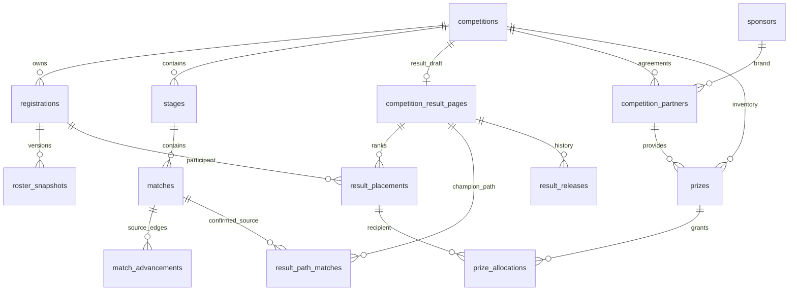

# GDUF CS 最终排名与赞助展示技术开发方案

版本：V1.0｜2026-11-09｜时区：Asia/Shanghai  
交付性质：**技术设计与冻结基准归档，尚未开发、迁移、提交或部署。**  
视觉基准：本轮最终确认的 `GDUFCS-results-v6.html`。随附归档中的 `reference/index.html` 与该文件字节一致，SHA-256 见 `manifest.json`。

## 1. 已确认的产品要求

1. 最终排名是站点一级页面，与“首页、赛事、赛程、战队、公告”并列。正式入口 `/results`，主导航顺序为：首页、赛事、赛程、战队、最终排名、公告。
2. 前端按 V6 冻结页面精确迁移。保留整体布局、字体、配色、冠军海报、纪念章、亚季军横条、冠军路径、排名表、装备展示台、赞助区和页脚。
3. 不恢复赛事面包屑、赛事二级导航、动效开关或“重播入场”按钮。最终排名不是 `/competitions/:slug/standings` 的改名，也不是赛事二级栏目。
4. 动效默认开启：首屏入场、纪念章扫光、光晕、点状高光、桌面指针倾斜和滚动显现，参数及效果以冻结源码为准。此项是用户明确确认，不沿用旧稿的默认关闭策略。
5. 冠军纪念章采用 V6 香槟金金属、深蓝珐琅、立体字与定向高光设计。不能恢复 V5 的旧配色，更不能换回通用 CS2 游戏海报或生成图片。
6. 队名、英文名、队标、徽章缩写、名次、比分、赛季、奖品、赞助商均可由实际数据替换。示例文本不能成为业务逻辑中的常量。
7. 与现有赛事、队伍、赛程、比赛详情、当场名单、直播回放使用同一套关联 ID 和正式数据，不另建平行队伍库、比赛库。
8. 本轮仅交付本方案及设计基准包。以下“新增”“修改”“实现”均为后续开发要求，不是已完成事实。

## 2. 读取依据与当前实际状态

本方案根据本机 `GDUF CS` 项目现有源码及开发文档编写。根目录为 `C:/Users/genev/Desktop/workspace/GDUF CS`。没有读取真实 `.env`、数据库内容、管理员凭据或生产用户资料。

| 已读取位置 | 本方案依据 |
| --- | --- |
| `README.md`、开发文档 00 / 04 / 07 / 08 / 11 | Vue 3 + TypeScript、FastAPI、SQLAlchemy、Alembic、PostgreSQL；冻结还原；demo/API 双模式；历史路由与功能保留 |
| `backend/app/db.py`、`roster.py` | 赛事、当届报名队伍、名单版本、队伍资料快照、审计及管理员接口 |
| `backend/app/tournaments.py`、`results.py` | 三类赛制、晋级关系、季军赛、双败重置、正式成绩及修正 |
| `backend/app/public.py`、`content.py` | 公开 DTO、图片上传、比赛、回放与赛事资料接口 |
| `backend/app/main.py`、`security.py`、`page_checks.py` | 响应封装、公开接口短缓存、鉴权、CSRF、HTML 资源存在性校验 |
| `frontend/src/Public.vue`、`main.ts`、`redesign/*` | 公共外壳、路由分派、模板渲染、公开接口读取、本地字体和现有样式 |
| `frontend/scripts/build-routing.mjs` | 静态部署路由白名单及 sitemap 生成 |
| V6 HTML 与已保存截图 | 本页最终视觉与交互基准 |

### 2.1 已有能力，必须复用

- `competitions`：`id / slug / name / season / status / published / config / revision` 等。`is_default` 表示现有默认赛事，不能直接等同于“最近已发布最终排名”。
- `registrations`：赛事内队伍的 `id / competition_id / code / name / logo / version / active`。`code` 参与 Excel 更新匹配，同届唯一。
- `roster_snapshots`：以 `(registration_id, version)` 保存 `name / description / logo`；`registration_members` 按名单版本保存成员。
- `matches`：已关联赛事、阶段、双方队伍、来源、BO、正式结果、胜者、`confirmed / published / version / rosters`。
- `match_advancements`：真实晋级边；`stages`：赛制、参赛项、分组及重置规则。
- `live_streams`：赛事及可选比赛关联的直播与回放。
- `audit_logs`：沿用单管理员操作审计。
- 图片上传 `POST /api/v1/admin/assets`：现有实现接收 PNG/JPEG/WebP，上限 2 MiB、边长 4096px，解码后转存 WebP，返回 `/media/...`。

### 2.2 当前缺口

- 没有独立最终排名页、最终名次发布表、奖品和赞助商业务表。
- `/stages/{id}/standings` 计算阶段积分，不是跨阶段最终名次算法。
- 当前当届资料没有独立英文队名、展示用徽章缩写、冠军海报断行字段。
- 名单普通修改在生成赛程后受锁定保护；已有的有理由名单修订创建新版本，旧比赛继续引用原版本。
- 公开页面分类器、Nginx 生成白名单、后端 page-check、sitemap 均未覆盖 `/results`。
- 现有公开 DTO 没有完整排名/奖品/赞助聚合契约。不能只写一页 Vue 就宣布整合完成。

## 3. 实施边界与设计权威

优先级：用户本轮明确要求 > 本方案中 V6 的确认项 > 冻结 HTML 源码及资源 > 项目已有业务与安全约束 > 旧版视觉说明。

V6 对“最终排名一级页面、默认动效、无控制按钮、金蓝纪念章”的确认覆盖旧稿中冲突要求；**不授权重做其他页面、删除旧路由或改写旧冻结稿**。其他页面仅增加最终排名主导航及必要的数据复用。

冻结基准必须只读保留。正式实现可拆成 Vue 组件、抽离 CSS/字体/SVG，不能靠修改基准使截图验收通过。后续审美调整另立版本。

原型“下载此预览”是现有可见交互，精确迁移时保留；正式页导出当前公开版本的离线 HTML，嵌入已校验的公开数据、字体和允许的图片资源，不包含 Cookie、后台接口或真实联系方式。不能以存在后台数据为由直接导出整份模型。后续若希望删除这个入口，另行记录设计变更。

## 4. 页面与导航接入

### 4.1 前台路由

| URL | 行为 |
| --- | --- |
| `/results` | 一级入口；展示最近一次已发布且有效的排名发布版本。没有版本则显示“最终排名待公布”，HTTP 200 |
| `/results/:slug` | 对应 `competitions.slug` 的历史结果页；赛事未公开、结果未发布或已失效时真实 HTTP 404 |
| `/results?edition=:slug` | 可兼容旧分享形式，规范化跳转到 `/results/:slug`；不是赛事子页面 |
| `/matches/:id` | 保留既有比赛详情入口 |
| `/competitions/:slug/teams/:id` | 保留既有队伍详情/名单入口 |

默认选择规则由后端确定：有效公开发布记录的 `published_at DESC, id DESC`，不按字符串赛季排序，不盲选 `Competition.is_default`，不自动为进行中赛事造冠军。结果页仍属于选中的赛事数据，但其信息架构是站点一级入口。

V6 没有可见赛季下拉，不自行加新控件。历史记录通过稳定 URL 访问；后续需要历史选择器时另作版式确认。工具条中的赛季名称来自选中结果。

### 4.2 文件触点（规划，尚未创建）

| 文件/模块 | 后续改动 |
| --- | --- |
| `frontend/src/Public.vue` | 复用页头页脚；加入一级导航及 active 判定；在 `/results*` 分派新组件；避免旧 `loadPublic` 给结果页误加载当前赛事 |
| `frontend/src/Results.vue` | 结果页状态、公开数据、版本刷新、搜索、奖品切换、弹窗和导出 |
| `frontend/src/results/ChampionSeal.vue` | 迁移 V6 SVG 与材质参数，只绑定经过校验的标识内容 |
| `frontend/src/results/reference-v6.css` | 迁移被冻结的样式和断点，作用域限于结果页；公共页头复用项目样式 |
| `frontend/src/results/types.ts`、`api.ts` | DTO 类型、聚合请求与错误状态 |
| `frontend/src/results/demo-v6.json` | 独立赛后示例；不得覆写现有进行中的秋季赛示例 |
| `frontend/src/redesign/presentation.ts` | 加入一级结果路径、页面标题、noindex 与状态分类 |
| `frontend/scripts/build-routing.mjs`、`backend/app/page_checks.py` | 加入结果入口、历史公开性校验与 sitemap 规则 |
| `frontend/src/Admin.vue` 及拆分的结果管理组件 | 增加后台结果/奖品/合作方维护区域，沿用 Element Plus 后台风格 |
| `backend/app/final_results.py`（建议名） | 草稿、计算、校验、冻结发布、失效处理及聚合读取 |
| `backend/app/db.py`、`schemas.py`、迁移目录 | 第 7 节提出的字段、表和约束 |

导航 active：`/results` 和 `/results/:slug` 只点亮“最终排名”，不同时点亮“赛事”。取消 V6 独立文件的 `target=_blank` 内站链接，使用 Vue Router；站外链接才新开窗口。

## 5. 逐项可替换的数据映射

**不能把 V6 当图片截图嵌入产品。** 页面必须是可绑定数据、可搜索和可交互的真实 DOM；设计装饰保留 SVG。

| V6 可见内容 | 正式数据来源 / 替换规则 |
| --- | --- |
| `2026 秋季赛`、页头赛季 | `competitions` 与结果页展示元数据；不得从本机日期拼冠军年份 |
| `KAPOK / FIVE` | 冠军关联的队伍英文名及合法 `poster_title_lines`；不是单独录一支“海报队伍” |
| `木棉 FIVE / 金融风暴 / 北苑竞技` | 关联 `registrations.id` 对应的已冻结公开队伍资料 |
| `MF / FS / NA` 与排名表缩写 | 可配置 `emblem_text`；默认从已有 `code` 派生。导入匹配码与展示缩写分离 |
| 纪念章中心 `MF` | 冠军队伍同一 `emblem_text`，或同一队伍上传的公开队标；禁止另录无关联 MF 常量 |
| 纪念章顶部 `KAPOK FIVE` | 同一冠军队伍英文名 |
| 纪念章环文 `FALL 2026`、编号 `001` | 结果页 `seal_edition_label / seal_serial`；编号为展示值，不推导真实历史届数 |
| `CHAMPIONS / 冠军`、`01` | 排名语义与区间；只有唯一第 1 名才能生成冠军模块 |
| 亚、季军及奖励 | 最终名次记录和该队实际奖品分配；禁止按队伍数组下标推断获奖者 |
| 决赛 `3 : 1`、双方、地图 | 明确绑定的正式比赛，引用 `matches.result` 与其版本；不允许后台另填一套比分 |
| 冠军之路三场比赛 | 真实比赛 ID 列表，经后端验证冠军参赛、比赛已确认及顺序；示例恰为三场，不强制真实赛事只有三场 |
| 表格名次 `5–8` | `rank_from / rank_to` 显式区间，组内稳定排序不表示独占第 5 名 |
| `8 支示例队伍` | 当前结果记录数量；搜索时展示匹配数 |
| 奖品图片、型号、文案、单位、获奖队伍 | `prizes` + `prize_allocations` + 队伍关联；切换时统一更新 |
| `NEXCORE` 及介绍、合作详情 | `sponsors` + `competition_partners`；不是 HTML 中任意替换品牌字符串 |
| 合作伙伴四列 | 该赛事有效合作项，按 `display_order`；不得自动复用另一届的商业合作 |
| `15 件获奖外设 / 40 枚参赛徽章` | 按分配记录计算，不能固定 15/40 或“队数 × 5” |
| 首席商标、伙伴 Logo | 已验证 `/media/...` 资源或系统内置矢量标识；产品实际内容应允许换品牌 |
| 回顾入口 | 现有 `live_streams` 的合法回放，赛事范围取决于当前结果；无回放呈现真实空态 |

固定界面词、样式、轮廓和装饰保留在组件中；业务名字、图片、赛事结果与合作内容来自数据。允许固定 `冠军/亚军/季军` 标签，不允许固定其对应队伍。

### 5.1 队伍资料与历史版本

1. 新增 `registrations.english_name`（字符串 120，默认空）、`emblem_text`（字符串 12，默认空）、`poster_title_lines`（JSON 字符串数组，默认空；1～2 行）。`code` 仍是既有同届报名匹配码，保留唯一约束与现有不可随意修改行为。
2. `roster_snapshots` 同步增加上述三个展示字段，旧快照以空值迁移；展示层回退到原 `code / name`。不补造旧英文名。
3. 修改这些资料进入现有名单版本修订流程；不得为了换 Logo 绕开生成赛程后的锁定规则。增加只读英文与缩写表单，不改变成员认领及 SteamID 约束。
4. 当前队伍卡片与队伍详情读当前版本；既有比赛详情仍读 `matches.rosters` 指向的历史版本。这是已存在的历史保护，不是数据不一致。
5. 最终结果发布时冻结一个明确的展示资料版本；默认采用最终决赛/最近决定性正式比赛的对应队伍版本。管理员如需使用修订后的品牌版本，须显式选择，并记录理由、展示版本与比赛名单版本的区别。
6. 所有模块以同一 `registration_id` 关联。冠军主标题、纪念章、名次表、奖品获奖队伍必须来自发布快照中的同一个 Team DTO；不得各组件自行请求并拼接新旧版本。
7. 已发布结果的资料不随普通改名即时变化。通过“创建修订稿 → 预览 → 重新发布”更新；旧发布记录不可覆盖。此前比赛的历史名字仍保持原版本。

## 6. 业务关系图



说明：图中业务关系不代替下述复合外键与同届校验。`result_releases` 保存不可变的整页公开快照；`competition_result_pages.current_release_id` 只是当前可见版本指针，不形成另一个数据来源。

## 7. 数据库增量设计（拟新增）

数据库名为建议命名，开发时不得误认为现有表。时间戳统一 UTC 存储；浏览器按 Asia/Shanghai 展示。主键沿用项目 UUID 字符串方式。金额不是本页必填项，不以虚构售价推算真实赞助金额。

### 7.1 `competition_result_pages`：每届一份结果工作稿

| 字段 | 类型 / 约束 | 用途 |
| --- | --- | --- |
| `id` | UUID PK | 结果工作稿 ID |
| `competition_id` | FK competitions，UNIQUE，非空 | 一届一份工作稿，禁止孤立结果 |
| `version` | int，默认 1 | 后台乐观锁；所有子项修改均递增 |
| `draft_state` | draft / ready，默认 draft | ready 仅表示校验就绪，不代表公开 |
| `final_stage_id` | FK stages，可空 | 决定最终名次的阶段 |
| `final_match_id` | FK matches，可空 | 确定冠军的实际终局比赛，双败可能为 reset |
| `third_place_match_id` | FK matches，可空 | 可选季军赛，不可将其当总决赛 |
| `ranking_method` | single / group_single / double / manual，非空 | 推导策略及手工裁定策略 |
| `rules_version` | string 40 | 算法/裁定规则版本，用于追溯 |
| `display_meta` | JSON 白名单 | `edition_label, season_label, seal_edition_label, seal_serial` |
| `seal_mode` | monogram / team_logo，默认 monogram | 纪念章标识模式 |
| `current_release_id` | FK result_releases，可空 | 当前有效公开版本；必须指回本结果页 |
| `created_at / updated_at` | timezone datetime | 管理记录 |

**同届约束：** 为 stages、matches 增加可被复合外键引用的 `(id, competition_id)` 唯一键；以上阶段/比赛关联采用 `(目标ID, 本表competition_id)` 复合 FK，或同等数据库约束。发布事务仍复核公开状态、终局属性及确认版本。

`display_meta` 不接受任意 CSS、JS、SVG、URL 或 HTML；配色和动效参数是冻结的程序配置，不在本轮扩成自由主题编辑器。

### 7.2 `result_placements`：名次工作项

| 字段 | 类型 / 约束 |
| --- | --- |
| `id` | UUID PK |
| `result_page_id / competition_id` | 同届结果页复合 FK |
| `registration_id` | 同届 registrations 复合 FK；UNIQUE(result_page_id, registration_id) |
| `team_display_version` | int；FK roster_snapshots(registration_id, version) |
| `rank_from / rank_to` | int；数据库 CHECK 1 ≤ rank_from ≤ rank_to ≤ 32；服务层另校验不超过本届实际结果人数，不能在 CHECK 中跨表查询 |
| `display_order` | int，仅控制同区间内部稳定顺序 |
| `source_method` | calculated / ruling |
| `deciding_match_id` | 同届 matches FK，可空 |
| `ruling_reason` | text；手工改变计算名次时必填 |
| `eligibility_policy` | starters_only / full_roster / explicit_count |
| `recipient_count` | 非负 int；explicit_count 须有理由；发布快照固定该人数 |

数据库只做行级 CHECK 与关联唯一性；区间组的基数、不同名次组是否重叠等跨行规则由发布服务在事务中验证，不用不完整的行级约束假装已解决。

`rank_from=5, rank_to=8` 允许 4 支队伍同组；不把后续记录保存成独占第 6、7、8 名。禁止同时存在唯一第 5 名与重叠的 5–8 名组。

### 7.3 `result_path_matches`：冠军路径工作项

`id, result_page_id, competition_id, match_id, display_order, stage_label`。

- UNIQUE(result_page_id, match_id)，排序值同页唯一。
- `match_id` 必须同届、已公开、已确认，并含冠军队伍。按实际阶段/赛程顺序，不按前端数组位置推导。
- `stage_label` 可为阶段显示别名，不能覆盖双方或比分；不自动把所有比赛都叫“半决赛”。
- 能显示 1～N 场；超过桌面三个格子的内容仍采用相同单元格横向滚动/换行策略，移动端纵排。V6 示例 3 场时必须原样。

### 7.4 `sponsors`：可复用品牌资料

`id PK, name(120), english_name(120), display_code(32), logo_url, tagline(200), introduction(2000), official_url(nullable), builtin_mark_key(nullable), active(bool), version(int), created_at, updated_at`。

`logo_url` 只能是已上传图片的 `/media/...`；`builtin_mark_key` 只允许程序内置的受信任矢量键，V6 demo 使用 `nexcore`。正式品牌可以上传自己的 Logo，不要求长得像 NEXCORE。空外链不显示空跳转，示例品牌不提供假官网。

### 7.5 `competition_partners`：某届赛事的合作关系

`id, competition_id FK, sponsor_id FK, tier(presenting/official), category, display_order, support_description, published(bool), version(int)`。

- 同届同品牌 UNIQUE；首席赞助商至多 1 个，采用应用事务校验，并在 PostgreSQL/SQLite 迁移中创建适用的 presenting 条件唯一索引。
- 品牌全局 active 不代表其支持所有赛事；页面只读本届已发布合作关系。
- 正式完整页面发布要求有一个首席赞助商；未确认合作的赛事保持结果草稿，不能拿另一届品牌补位。官方伙伴允许 0～N 个，零个时显示正常空态而不是自动制造四个品牌。

### 7.6 `prizes`：赛事奖品

`id, competition_id FK, provider_partner_id FK, category(equipment/commemorative), model_code(40), name(160), unit(16), description(2000), image_url(nullable), builtin_illustration_key(nullable), display_order, active(bool), version(int)`。

- 使用 `provider_partner_id` 明确关联本届合作项；禁止关联到别届赞助关系。
- 图片复用现有上传；内置 `headset/keyboard/mouse` 仅为受信任的示意资源。正式后台允许换真实产品图。
- 装备类型不能只靠奖品名称包含“耳机”来识别。其类型字段驱动支持数量统计；纪念徽章不计入“获奖外设”。
- 不新增购物车、领取地址、物流及付款功能，本轮只处理赛事奖励展示。

### 7.7 `prize_allocations`：明确到队伍的奖励分配

`id, competition_id, placement_id FK, prize_id FK, quantity(int > 0), distribution(per_team/per_recipient), per_recipient_quantity(nullable), remarks, display_order`。

- UNIQUE(placement_id, prize_id)。同届复合 FK，禁止把某队奖品分配给其他赛事。
- `quantity` 是该队总数量；若按人，发布时校验 `quantity = recipient_count × per_recipient_quantity`。
- 全员徽章也生成每队一条分配；前三名已经包含的徽章不能再重复计数。装备支持数 = equipment 类数量和；徽章支持数 = commemorative 类数量和。
- 示例冠军、亚军、季军各 5 件外设，总计 15；8 队各 5 枚徽章，总计 40。真实队数/替补资格不等于此样例。

### 7.8 `result_releases`：不可变公开版本

| 字段 | 类型 / 规则 |
| --- | --- |
| `id` | UUID PK |
| `result_page_id / competition_id` | 同届 FK |
| `release_number` | 同页递增整数；UNIQUE(result_page_id, release_number) |
| `status` | published / withdrawn / invalidated |
| `schema_version` | DTO 结构版本，例如 1.0 |
| `source_fingerprint` | 正式比赛/阶段/名单及工作稿输入的规范化哈希 |
| `source_dependencies` | 内部 JSON：相关 Match ID+version、Stage 配置哈希、名单展示版本、合作/奖品版本；不公开管理字段 |
| `public_snapshot` | 只保存公开白名单数据的完整整页 DTO，发布后不可改 |
| `content_sha256` | 对 public_snapshot 规范化序列化后的 SHA-256 |
| `published_at` | UTC datetime |
| `reason` | 发布/修订/撤回说明；重新发布须填写 |
| `invalidated_at / invalidation_reason` | 失效记录，可空 |

快照中的文本、队伍/Logo、产品/Logo URL 都有明确来源，不能包含 `contact / steam_id / admin notes / sessions / draft_result`。快照对应的媒体文件须保留，不允许后台清理时删除历史发布仍引用的图片。

## 8. 最终名次算法与裁定

### 8.1 输入与硬门槛

读取所选阶段的实际参赛项、已公开比赛、正式确认结果和晋级边；确定是否存在季军赛、双败总决赛重置及跨阶段晋级。**不按队伍名称、数组顺序、比赛 ID 大小、最后更新时间或“胜场最多”直接选冠军。**

候选名次计算不等于发布。发布要求赛事为 completed 或 archived、赛事已公开、决定性比赛终局已确认、没有待裁定的名次冲突。

### 8.2 各赛制规则

| 赛制/状态 | 处理 |
| --- | --- |
| 单败 `single` | 最终上胜区终局比赛胜者为第 1、败者第 2；从图结构识别 final，不假设所有终局 `bracket` 都叫 final |
| 有季军赛 | 必须等待 `bracket=third` 正式结果；胜者 3、败者 4 |
| 无季军赛 | 两名半决赛败者同为 3–4；**不能硬造独立季军**。前三名模块改为“并列季军 / 3–4”，其余视觉组件保持同款，差异作为真实内容状态记录 |
| 四分之一决赛败者 | 按已公布规则并列 5–8；轮空不算获胜，也不生成虚构地图比分 |
| `group_single` | 淘汰赛部分按 playoff 图推导；小组未晋级者不能只按各组局部积分跨组强排，须使用赛事明确的跨组规则或统一区间；无规则时阻止发布并提示裁定 |
| 双败 `double` | 检查 final 与 reset。重置被合法取消则以 final 终局为准；重置实际触发则必须等 reset 正式结果。其余队伍按实际最后淘汰阶段分组；不能复用单败轮次公式 |
| 纯小组/复杂自定义阶段 | 本轮未识别的图不输出猜测结果，进入有理由人工裁定流程；后端公布其 source_method 与审计来源 |
| 弃权/技术判负 | 名次可以依据正式胜者，但显示异常结果标签；现有计算返回 0:0 时不能把 0:0 当真实系列赛比分，更不能伪造 3:0/地图 |
| 取消/未确认/待定双方 | 不参与冠军判定，不能发布完整最终结果 |

### 8.3 区间与完整性校验

- 每个被纳入最终名次的参赛队伍只出现一次，所有队伍必须同届。
- 一个独立名次组 `[a,b]` 的成员数量必须等于 `b-a+1`；不同组不能重叠，正常全量结果的分组从 1 覆盖到参赛队数。
- 退赛、取消资格等例外使用显式状态及理由；不得为凑满数字插入虚构队伍。缺资料保留草稿，或者明确发布经裁定的例外组，不能冒充完整正常排名。
- 唯一冠军/亚军必须与决定性正式比赛一致。人工裁定不是篡改比分的入口；争议冠军必须先通过原比赛修正流程处理。
- 排名工作项覆盖该届实际结果范围，不能因为示例只有 8 支就截断真实 16/32 支队伍。

### 8.4 冠军路径

后端以胜者身份选择冠军真实参加的已确认比赛，管理员可指定展示阶段范围并排序。仅列实际比赛，轮空显示为来源说明而非 2:0。路径弹窗必须绑定所点击比赛；V6 的半决赛/八强只有简要信息，正式版复用现有详情能力补齐逐图比分、异常状态、回放链接。

从发布快照弹出的历史比分读取该 release 内冻结的 Match DTO；“打开比赛详情”跳到既有 `/matches/:id`。不混用旧排名快照和后端已修正的新比分。

## 9. 后台管理与发布闭环

后台仍只有原单管理员，无新账号体系。结果管理建议挂在“赛事管理 → 选中赛事 → 最终排名与奖励”，公开入口的一级地位不要求后台也做独立全站模块。

流程：

1. 维护赛事、队伍、Logo、英文显示名与展示缩写；按原流程发布赛程、录入并确认成绩。
2. 新建结果工作稿，选择最终阶段、实际总决赛/重置赛/季军赛；生成候选名次。
3. 对歧义组填写裁定理由，完整校验所有名次与队伍版本；选择冠军路径。
4. 维护品牌库 → 本届合作关系 → 奖品 → 各队分配。Logo/产品图先上传并预览；不允许任意 HTML。
5. 内部预览整个结果页，使用真实工作稿，不会进入公开 API。预览复用同一前台组件，通过受鉴权的预览 DTO 渲染，不复制一套后台视觉。
6. 校验页显示缺项、跨届引用、参赛人数/奖品数量不匹配、结果冲突及源版本；管理员确认后发布。
7. 后端事务生成 immutable release、写快照、切换公开指针、递增版本、写审计；成功后站点 `/results` 可读取。
8. 后续修改只改工作稿，公开版本继续保持原样；再校验、说明原因并发布新版。撤回/失效不删除历史审计和快照。

内部预览路径可为 `/admin/competitions/:id/results/preview`，不得让公开 `?preview=1` 绕过登录。管理按钮状态：未建档、草稿、校验未通过、可发布、已有公开版本、来源已失效、已撤回。

### 9.1 并发与事务

- 所有结果工作稿写入、奖品/合作项变更、计算、发布操作携带 `expected_version`。
- 统一锁序：Competition → ResultPage → 必要的源记录，避免与现有录分流程形成相反锁序。PostgreSQL 用行锁；SQLite 验收环境增加 CAS 版本更新和重读，不能用“SQLite 忽略 FOR UPDATE”当并发验证通过。
- 不仅比较 `Competition.revision`：该字段目前不能覆盖所有比赛修改。发布前重算 source_fingerprint，比较预览时输入，再验证同一事务快照。
- 工作稿版本不符或源依赖变化返回 409；不得以“只有一个管理员”忽略同账号多标签页冲突。
- 发布请求支持 `Idempotency-Key`；同工作稿版本、源哈希及请求键重复发送返回同一 release，不重复分配奖品、不生成两条发布记录。
- 多进程环境不能只使用进程内锁；约束与事务以数据库为准。

## 10. 正式赛果修正与排名失效

1. 在现有 `revise-preview` 返回值中追加受影响的已发布排名 release ID；保留原有下游比赛阻断。
2. 正式确认/修正、阶段晋级裁定变更、影响已发布结果的赛程取消或阶段配置变更，在原写入事务内检查 `source_dependencies`。
3. 若公开版本依赖的比赛胜者、比分、晋级或终局规则发生变化：将该 release 标记 invalidated，清空页面公开指针，写审计。**不能只把后台草稿标记 dirty、继续公开旧冠军。**
4. 新结果经过重新计算/校验/发布后才能恢复。`/results` 可以选择另一份有效已发布结果；对应历史 `/results/:slug` 暂无有效结果时返回 404。
5. 普通品牌介绍改动、未来名单修订不自动重写旧发布快照；在后台提示“公开版仍使用版本 X”，管理员有理由重新发布。历史图片文件保留。
6. 有新比赛、新晋级等影响范围难以精确判定时，采用保守策略：失效该届相关 release，不能静默假定无影响。
7. 当前内存 GET 缓存只有单进程清理与 2 秒 TTL。新增结果聚合接口应排除现有短缓存并返回 `Cache-Control: no-store`，避免修正后短时间内仍返回已失效冠军；未来若缓存，必须使用发布版本键与跨 worker 失效机制再单独验收。

## 11. 拟新增 API 契约

所有成功响应继续 `{ "data": ... }`，错误继续 `{ "error": { "code", "message", "details", "request_id" } }`。公开接口只读。以下地址是规划，不是现有可调用接口。

### 11.1 公开 API

| 方法 / 路径 | 返回 / 规则 |
| --- | --- |
| GET `/api/v1/results/latest` | 最近有效发布的完整 DTO；无结果 `data: null` |
| GET `/api/v1/results/editions` | 有效公开历史结果：competition_id、slug、name、season、release_id、published_at；只用于链接/后续扩展，不强行增加可见下拉 |
| GET `/api/v1/competitions/{key}/results` | 对应赛事当前有效发布 DTO；未知/未公开/无有效发布 404 |

比赛、队伍和回放跳转继续使用现有公开 API 与路由。以上聚合 DTO 已包含整页要用的公开数据，前端不逐行发 8～32 次队伍/奖品请求。

### 11.2 管理 API（统一前缀 `/api/v1/admin`）

| 方法 / 路径 | 作用 |
| --- | --- |
| GET/PUT `/competitions/{key}/final-results/draft` | 读/创建/更新结果基本配置，expected_version |
| POST `/competitions/{key}/final-results/calculate` | 根据正式赛果产生候选工作项，不公开；返回警告和依赖哈希 |
| PUT `/competitions/{key}/final-results/placements` | 原子替换名次工作项，验证同届与理由 |
| PUT `/competitions/{key}/final-results/path` | 保存冠军路径 ID 与顺序 |
| GET `/competitions/{key}/final-results/preview` | 内部完整预览 DTO，Cache-Control:no-store |
| POST `/competitions/{key}/final-results/validate` | 完整发布校验，返回 draft_version、source_fingerprint、warnings、blocking_errors |
| POST `/competitions/{key}/final-results/publish` | expected_version + expected_source_fingerprint + reason；支持幂等键 |
| POST `/competitions/{key}/final-results/withdraw` | expected_version + reason；撤回当前公开指针，保留历史 |
| GET `/competitions/{key}/final-results/releases` | 历史版本、来源和发布记录；仅管理员 |
| GET/POST `/sponsors`，PATCH `/sponsors/{id}` | 品牌资料维护，expected_version |
| GET/POST `/competitions/{key}/partners`，PATCH `/competition-partners/{id}` | 本届合作关系 |
| GET/POST `/competitions/{key}/prizes`，PATCH `/prizes/{id}` | 本届奖品 |
| PUT `/competitions/{key}/final-results/allocations` | 原子保存奖励分配并校验数量 |

品牌和奖品停用使用 active 标记，不硬删历史引用。改动已存在引用的业务实体必须记录审计；所有管理写请求沿用 Cookie、Origin、CSRF，不能另设无鉴权的静态 JSON 写入口。

### 11.3 关键错误码

| HTTP | code | 情形 |
| --- | --- | --- |
| 404 | NOT_FOUND | 赛事/公开结果不存在或不可见 |
| 409 | VERSION | 工作稿 expected_version 过期 |
| 409 | SOURCE_CHANGED | 正式赛果/依赖版本与预览不符 |
| 409 | RESULT_NOT_FINAL | 终局未确认、reset 待打或决定性比赛未完成 |
| 422 | CROSS_COMPETITION | 队伍/阶段/比赛/奖品跨届关联 |
| 422 | RANKING_AMBIGUOUS | 名次组歧义、跨组无裁定规则 |
| 422 | INVALID_RANK_RANGE | 名次组重叠、区间人数错误或缺队 |
| 422 | AWARD_QUANTITY | 奖品与获奖人数不匹配 |
| 422 | PUBLISH_INCOMPLETE | 缺首席合作方、冠军标识或必要资料 |
| 503 | SERVICE_UNAVAILABLE | 数据服务不可用；不回退示例冠军 |

## 12. 公开 DTO 的稳定形状

下例表示结构，UUID/媒体路径由实际记录产生。文档中的占位字串不是可播种真实数据。完整示例场景见归档 `data/demo-v6.json`。

```json
{
  "data": {
    "schema_version": "1.0",
    "release": {"id": "<release_uuid>", "number": 1, "published_at": "<utc_iso8601>"},
    "competition": {"id": "<competition_uuid>", "slug": "autumn", "name": "2026 秋季赛", "season": "2026"},
    "display": {"edition_label": "2026 秋季赛", "seal_edition_label": "FALL 2026", "seal_serial": "001"},
    "champion": {
      "team_id": "<registration_uuid>", "display_version": 1,
      "name": "木棉 FIVE", "english_name": "KAPOK FIVE", "emblem_text": "MF",
      "logo_url": null, "poster_title_lines": ["KAPOK", "FIVE"], "seal_mode": "monogram"
    },
    "final_match": {
      "id": "<match_uuid>", "version": 3, "best_of": 5, "result_type": "normal",
      "a_team_id": "<team_a_uuid>", "b_team_id": "<team_b_uuid>",
      "winner_team_id": "<team_a_uuid>", "wins_a": 3, "wins_b": 1, "maps": []
    },
    "placements": [],
    "champion_path": [],
    "prizes": [],
    "allocations": [],
    "presenting_partner": {},
    "official_partners": [],
    "support_totals": {"equipment": 15, "commemorative": 40}
  }
}
```

真实终局为普通已完成比赛时，maps 必须填真实已确认地图；上例空数组仅为省略结构，不能作为真实普通 BO5 的合法发布数据。字段中 team_id 均引用同一队伍集合；`placements[].team` 包含冻结 Team DTO。`final_match.teams[]` 也返回冻结公开身份信息，避免用数组位置假设冠军永远是 A 方。

奖品 DTO 包含 `id / model_code / name / unit / description / image_url / builtin_illustration_key / provider_partner_id`；分配包含 `placement_id / registration_id / prize_id / quantity / distribution / recipient_count`。公开 DTO 不输出内部裁定备注全文；如需公开争议说明使用专门的 public_note 白名单字段。

数据枚举不能直接暴露成界面中文标签。前端将后端合法枚举映射到文案；未知枚举呈现安全空态并记录错误，不猜测胜者。

## 13. 前端精确迁移与动态替换

### 13.1 冻结结构

公共页头 → 独立工具条 → 冠军主视觉与金蓝纪念章 → 决赛横条 → 亚军/季军横条 → 冠军路径 → 完整名次表 → 可切换装备展示台 → 首席赞助与合作伙伴 → 公共页脚。

V6 的主要 CSS 类名 `v4-* / v5-*` 是原型演进的历史命名，迁移可重命名组件内部实现，但必须保留等效几何与结果。不能因为名字里有 v4/v5 就退回旧版视觉。

以下是从 V6 源码定位的关键锚点，**不是重新设计的自由参数**；完整层叠、覆盖和细节仍以冻结 HTML 为准：

| 锚点 | V6 要求 |
| --- | --- |
| 公共页头 | 常规桌面 94px；1600px 起 106px；移动端沿用项目原重排规则 |
| 正文宽度 | `.results-width` 桌面 89%、max-width 1440px；760px 及以下 88% |
| 独立工具条 | 桌面 min-height 108px；移动端上下 padding 23px，无控件占位条 |
| 冠军主视觉 | 常规桌面两列 1:1、min-height 565px、perspective 1100px；1600px 起 min-height 650px；760px 及以下改单列 |
| 冠军标题 | 桌面 `clamp(100px,10.3vw,180px)`、800、行高 .78；移动端按 V5/V6 最终覆盖的受控单行样式，不能只复制最早 V4 规则 |
| 纪念章 | SVG viewBox `0 0 600 600`；默认 rotateX(7deg) rotateY(-13deg) rotateZ(-8deg)，对象占场景 92%；移动端使用其断点覆盖 |
| 新材质 | SVG `seal6-*` 所有渐变、三层 MF 字、分面、金属双边、环文、两个高光点原样保存 |
| 指针倾斜 | rotateX = 7 − y×12，rotateY = −13 + x×18，x/y 为中心归一化偏移；离开恢复默认值 |
| 动效时间 | 文字入场 .85s，延迟入场 .95s/.18s；纪念章入场 1.5s，移动端 1.1s；扫光桌面 9s、移动端 10s；光晕 7s；两个高光点 7s |
| 字号与数量 | 纪念章中央 MF 基准字号 150，KAPOK FIVE 13、序号 29；数据替换后按本节安全区域规则适配 |
| 层级与颜色 | 香槟金集中于冠军章；界面保持竞技蓝与黑灰。不把金色批量套到导航、表格、装备区或赞助 Logo |
| 不可恢复项 | 无游戏海报、无赛事面包屑/二级导航、无动效开关、无重播入场按钮 |

桌面截图和移动截图不一定刚好捕捉扫光最亮帧，不能据此删减自动扫光；以 SVG/CSS/JS 和动效验收为准。

### 13.2 纪念章

- V6 SVG 原样迁移为受信任组件，保留全部 gradient、clipPath、路径、字距、浮雕层、倾角、阴影和高光。不得用库里一个奖杯图标代替。
- 多实例/弹窗预览使用唯一的 SVG ID 前缀，所有 `url(#...)`、`textPath href`、clipPath 一起替换，避免首页/后台多个徽章颜色串用。
- `MF` 三层文字统一绑定同一 `emblem_text`；不能只改表层留下背面 MF。英文环文、年份、序号、KAPOK FIVE 也必须动态绑定。
- 上传队标模式将 Logo 放入同一盾面安全区域（约 x=205～395、y=220～350，viewBox 600），`preserveAspectRatio=xMidYMid meet`；轮廓、金属边与扫光不变，使用安全 `/media` 图片，不执行上传 SVG。
- 单/双字母徽章使用原字号；3～6 字符按安全区域等比适配；更长内容需后台预览并限制缩写为合理长度，不压到盾框。完整队名仍显示在正文，不用缩写替代。
- 默认动效开启且无可见开关/重播控件，与 V6 一致；不重新引入旧版按钮。离开路由后取消 RAF、监听器及 IntersectionObserver；后台标签页不进行无意义指针刷新。
- 指针倾斜仅 `(hover:hover) and (pointer:fine)`；移动端保持静态倾角及自动扫光，滚动不会被触控处理阻塞。

### 13.3 字体、图像与文字

- 保留本地 Barlow Condensed 500/600/700/800/900，SIL OFL 授权随资源分发；中文字体栈沿用冻结值。
- 样例内容必须像素级对照。正式长队名/英文名只允许采用明确的适配：保留最多两行海报标题，受控缩小字号；极端超长通过 title/完整队名区提供完整文本，不溢出、不挤压纪念章。
- 队伍 Logo 替换在约定槽位内 contain，不拉伸；赞助商 Logo 用相同品牌展示区域等比适配。奖品真实产品图在原展示台区域 contain，不能改成满屏商品图。
- 本页品牌、照片、标题等内容更新不改变其他页面的颜色、卡片、留白或背景。
- 内站元素点击改 Router 导航；搜索继续匹配队名、英文名，不由前端输入改变正式名次。无结果提示保留。

### 13.4 装备与弹窗

前三项示例按冠/亚/季军呈现，切换后统一更新：tab 选中态、index、背景型号、图片、产品标题、单位、获奖队伍、详情按钮与 `aria-labelledby`。支持左右键/Home/End，保留可见焦点。

正式某名次有多个奖品时，以该名次装备集合显示详情，展示台主项按 display_order；不把额外奖品藏到数据外。缺某名次装备时显示“该名次奖品待公布”，不得复制冠军耳机。并列季军展示相应两队与各自分配，不随意选其中一队。

成绩弹窗、奖品弹窗、合作详情复用同一安全弹窗框架；关闭/Escape/遮罩点击返回原位置和焦点。正式榜单条目可链接对应原队伍详情，但不能引入新卡片样式。

## 14. demo / API 模式与状态

- 沿用 `VITE_PUBLIC_DATA_MODE=demo|api`；新增结果页不自动修改该构建模式。
- demo 使用冻结结果数据；当前首页/赛事“进行中”仍为原示例。结果页标识“赛后示例”，不能将独立场景写回原秋季赛数据文件。
- API 模式只能读取有效公开 release；请求失败、空库、进行中赛事、未知 slug 均不回退 demo。
- demo 比分与奖品不写进真实数据库；不得为还原前端而伪造 SteamID、选手或真实赞助关系。

| 状态 | 正式表现 |
| --- | --- |
| 加载 | 在原结果主体区域呈现稳定骨架，防止纪念章区域跳动；不显示临时冠军 |
| `/results` 无发布 | 一级页外壳 +“最终排名待公布”，HTTP 200，不渲染假冠军/假品牌 |
| 指定历史结果不存在/未公开/失效 | 真实 404；不显示后台预览，不跳到示例 |
| 服务异常 | 原有错误/重试模式，HTTP/API 503 的语义保持，禁止返回成功空冠军 |
| 部分奖品未确认 | 工作稿可预览；正式发布按完整校验规则阻断，不能用固定样例填空 |
| 已发布历史页 | 读取该赛事有效不可变发布快照；正文正确表示其赛季 |
| 结果失效 | 清空可见指针；如用户已打开旧页，版本刷新后提示“结果已更新或撤回”并清理旧 DTO |

结果页延续项目约 30 秒可见页面刷新策略，使用单个请求票据防竞态；响应包含 release_id，同 ID 不反复重建页面和重播入场。新 ID 更新整页一次，确保冠军、路径、奖励同一版本。

## 15. 资源、安全与兼容

- 复用 `POST /admin/assets`，不新增无鉴权上传；后端验证 `/media/` 文件确实存在，绑定媒体引用。图片加载失败展示同槽位徽章文字或产品类型示意，同时保留真实名称，不请求不受控第三方图片。
- 外链仅允许合法 HTTPS；Logo 不接受远程任意 URL、data SVG 或脚本。内置 SVG 是开发者受信任资产，不作为可编辑 HTML 入库。
- 新组件优先使用 Vue 插值/属性绑定，避免把管理员可编辑字段直接拼入 `v-html`；必须复用旧模板时统一转义文本/属性并校验 URL。
- 保留公开 DTO 白名单、原管理员鉴权、CSRF、同源校验、日志与请求 ID。不要把全量 `serialize(model)` 直接返回公开结果。
- 新模块 CSS 限定于结果页根 class；不污染 Element Plus 后台或现有首页/赛事页。
- 现有 CSP、媒体 location、缓存和静态资源路径须回归；不要用放宽 CSP/关闭安全头来换取动效运行。

## 16. Nginx、路由与 SEO

1. `classifyPublicRoute` 与正式路由分派同时支持 `/results`、`/results/:slug`，不能只改 Vue Router 兜底。
2. `build-routing.mjs` 的 demo/API 资源正则增加结果页；静态文件 location、API location 优先顺序保持，不让 `/results/foo.js` 被当结果页。
3. `page_checks.py` 对 `/results` 返回可达；对 `/results/:slug` 校验赛事公开 + 存在有效 release，不应只检查 Competition.published。
4. page-check 本身不缓存；保持当前 Nginx 把无权/不存在映射为真实 404、校验服务异常映射 503 的约定。首个 HTML GET/HEAD 就必须正确，不能仅靠前端 noindex。
5. sitemap 增加 `/results`；历史 URL 仅收录有效公开 release，不能把所有赛事 slug 自动列为已存在排名页。当前仅稳定页的 sitemap 可先只收录一级入口。
6. 页面 title 为“最终排名 · GDUF CS”，历史页包含实际赛事名；分享描述不把演示冠军当真实消息。无结果和错误页按项目既有状态设置 metadata。

## 17. 数据迁移与上线顺序（后续执行）

1. 先备份并记录当前源码/镜像/数据库版本。迁移编号在实施时接在仓库最新 Alembic revision 后，本方案不预占编号。
2. 增量增加展示字段、快照字段、新业务表与复合约束；旧字段默认空值，旧比赛、队伍、名单、积分无需改写。结果页与 release 的循环引用使用先建页/发布表、后添加 `current_release_id` 外键的顺序；SQLite 使用 Alembic batch 方式验证，不能假设其支持与 PostgreSQL 相同的 ALTER TABLE。
3. 上线兼容后端、聚合/管理 API 和 page-check 后，再部署新前端及 Nginx 路由。旧前端不认识新接口仍应工作。
4. 后台先在独立验收赛事完成录分、名次、奖品、发布闭环；正式数据由管理员维护，不执行 demo 自动播种。
5. 通过状态与视觉验收后再发布生产结果。首次尚无 release 时 `/results` 显示正常待公布状态。
6. 回退优先回退可见前端和公开结果指针，保留新表与历史记录；不要为回滚页面直接删除奖品/结果数据。破坏性降级迁移必须先导出并确认恢复路径。

本轮没有上述任何上线操作，也没有宣称测试通过或生产已更新。

## 18. 开发阶段与交付要求

继续沿用项目“先集中实现，最后统一审查测试”的开发安排。下表是后续顺序，不要求本轮运行。

| 阶段 | 输出 |
| --- | --- |
| R1 数据与契约 | 增量迁移、Pydantic 请求 DTO、关联与版本约束、公开快照类型 |
| R2 后台与结果服务 | 资料替换、候选计算、裁定、奖品分配、预览/校验/发布/撤回 |
| R3 正式前端 | V6 精确迁移、一级导航、纪念章绑定、奖品/搜索/弹窗/离线导出、双模式 |
| R4 联动与部署配置 | 比赛修正失效、并发、媒体保留、page-check、Nginx、sitemap |
| R5 集中审查验收 | 后端、浏览器、视觉差分、数据替换与原功能回归；修复后复测 |

完成标准不是“页面能打开”。必须同时交付：可维护的真实数据、后台操作闭环、正式结果一致性、稳定一级路由、无硬编码身份、精确视觉、完整异常状态和验证证据。

## 19. 视觉与功能验收清单

### 19.1 V6 精确视觉验收

- 同一操作系统、浏览器、字体、缩放 100%、DPR、视口和示例数据，对冻结页与正式 demo 页截图叠加/差分。
- 覆盖 1920、1600/1599、1280、1051/1050、768、761/760、390、381/380、360、320 CSS px。
- 检查顶栏六个入口及 active、独立工具条、无二级赛事导航、无两个控制按钮。
- 检查冠军字号/断行、金蓝纪念章的每个材质层、环文、MF 浮雕、边缘高光、阴影、固定倾角、全页几何。
- 检查亚季军横条、冠军路径、全量排名、装备默认/亚军/季军状态、首席和伙伴区、页脚。
- 动效截图在**测试环境双方同时**固定为相同帧/终态再比较；不能修改冻结文件，也不能把截图时冻结动画理解为产品默认关闭。另用视频/浏览器轨迹验证完整入场、扫光、指针倾斜、滚动显现。
- 主要结构/布局/颜色无未经授权差异；只有相同环境下实际测得的字体栅格差异可单列说明。不能以“接近原稿”代替验收。

### 19.2 必测业务场景

| 场景 | 验收要求 |
| --- | --- |
| 改冠军队名/英文名/徽章缩写/Logo | 主海报、纪念章所有文字层、排名、奖品、弹窗同时读取关联数据；旧比赛历史版本保留 |
| 更换赞助品牌与产品 | 首席 Logo、详情、表格提供方、装备插画/产品图、伙伴列表和数量统计同步，无 NEXCORE 残留 |
| 16/32 队、非 5 人领取资格 | 全量名次显示；奖励按实际 recipient_count，15/40 不写死 |
| 无季军赛 | 并列 3–4，不假造独立季军；对应队伍奖励分配正确 |
| 双败 reset 必打/取消 | 依据真实终局判冠军，未终局阻断发布 |
| 弃权/技术判负 | 标签明确，不显示虚构 0:0 常规比分或假地图 |
| 赛果修正 | 原依赖 release 同事务失效；不再公开旧冠军；重发后所有模块同 release |
| 草稿变更 | 不影响已发布快照；预览始终鉴权 |
| 并发/重复发布 | 409 与幂等结果正确，无重复 release 或奖励 |
| 跨赛事关联 | 队伍/比赛/奖品/合作项全部拒绝 |
| 改名和历史版本 | 当前队伍详情与旧比赛快照关系清楚；最终结果不被静默重写 |
| 空库/API 失败/无合作 | 无示例回退或假品牌；公开性及空态正确 |
| 直接访问历史 URL、刷新、GET/HEAD | 正常可达或真实 404/503，错误页 metadata 正确 |
| 恶意队名/超长名称/非法 Logo URL | 无脚本执行、无破版、无非法外部请求；SteamID 和联系方式不公开 |
| 搜索/Tab/键盘/焦点/Escape | 与 V6 相同交互；奖品详情与当前选项一致 |
| 离线导出 | 下载文件可离线打开、资源完整、仅当前公开快照，无管理资料 |
| 原业务回归 | 三种赛制、Excel 预览/确认、成员冲突、原比赛录分/晋级/修正、直播、公告与后台登录均保留 |

后端至少在项目测试用 SQLite 与目标 PostgreSQL 分别验证迁移/约束；行锁与并发必须在 PostgreSQL 验证。浏览器验收包含真实 API 的隔离测试库，不使用生产数据播种。

### 19.3 证据交付

保存源码提交、构建模式、Alembic revision、测试日志、截图/差分、动效视频、关键 GET/HEAD 原始响应、样例替换前后证据、发布/修正审计。跳过或未运行的项目明确列出，不能用既往项目报告冒充本模块验证。

## 20. 本轮交付与后续边界

本轮实际交付：本 Markdown 技术方案、只读 V6 HTML、桌面/整页/手机截图、示例赛后 JSON、纪念章 SVG 源、字体许可、哈希清单及 ZIP 归档。

本轮**未实施**：Vue 改造、数据库迁移、后台表单、真实接口、Git 提交/推送或生产部署。本方案中的模型、接口和路径为可执行的后续设计，未声称已经存在。

后续开发必须先核对归档哈希，并按此版本实现。实际赛制、领取资格、真实品牌、队标和奖品由管理员录入；相关空值已有明确处理，不通过硬编码示例绕过缺项。默认只实现本方案范围，不附带商城、用户注册、社交评论或新的赛事算法体系。
