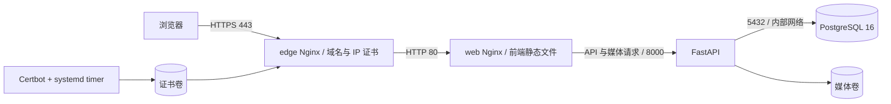

# 广金主场 · GDUF CS2 项目交接文档

交接日期：2026-11-09（Asia/Shanghai）。本文面向后续开发者、服务器维护者与赛事管理员。

状态依据为仓库源码、用户提供的服务器终端输出及公网只读检查；未通过 SSH 直接检查服务器。服务器命令由所有者在终端执行。文中的证书日期、版本和验证结果均为交接时快照，后续变更应同步更新本文。

## 1. 接手先看

| 项目 | 当前信息 |
| --- | --- |
| 正式网站 | <https://www.gdufcs.fun/> |
| 管理登录 | <https://www.gdufcs.fun/admin/login> |
| 健康接口 | <https://www.gdufcs.fun/api/v1/health>，正常返回 `{"data":{"status":"ok"}}` |
| 云服务器 | 阿里云 ECS，中国香港；公网 IPv4：`47.76.165.241` |
| 系统 | Alibaba Cloud Linux 3.2104 U13.4 / OpenAnolis Edition，兼容 RHEL 系列 |
| 主机名 | `iZj6c234k2untwdrwj2w90Z`（主机名，不作为实例 ID 使用） |
| 部署目录 | `/root/gduf-cs`，当前操作者使用 root |
| Docker / Compose | Docker 26.1.3 / Docker Compose v2.27.0；Docker 服务已确认 active |
| 源码仓库 | <https://github.com/klsdxf/GDUF-CS> |
| 完整实现分支 | `codex/implementation` |
| 合并请求 | [PR #1](https://github.com/klsdxf/GDUF-CS/pull/1)，交接时 open、未合并 |
| 最后确认的服务器源码 | `b8f2c95`；本次交接文档提交在其后，不代表服务器已拉取 |
| 管理员凭据 | 没有生产默认密码；是否完成初始化、账号名称及登录情况尚需所有者核验 |

2026-11-09 交接时，从外部网络检查正式主页及健康接口均为 HTTP 200，HTTPS 校验通过。健康接口会检查数据库连接，但不代表所有管理流程、比赛业务和备份恢复均已在生产验收。

当前使用 `www.gdufcs.fun`。裸域 `gdufcs.fun` 未确认配置解析、证书或跳转。服务器规格、磁盘容量及资源余量待核验。

## 2. 产品与代码范围

平台定位为广东金融学院学生社团 CS2 赛事展示与单管理员管理平台。游客免登录浏览，管理员维护赛事；没有面向选手的自主注册、报名和多管理员权限系统。

已实现的主要业务：

- 赛事创建、规则与地图池维护、发布、默认赛事选择、归档及稳定历史链接。
- 整队维护、队标上传、名单版本与历史快照。每队 5 名正式队员、最多 2 名替补，队长为正式队员。
- Excel v1 双表导入（“队伍”“成员”），先预览再整批确认；支持新增、更新、错误定位、版本冲突及重复提交处理。SteamID64 按原始文本处理。
- 单败、小组循环加单败、双败，支持 BO1/3/5、轮空、种子、分组、晋级及双败总决赛重置配置。
- 赛程草稿与发布、地图成绩草稿与确认、胜败推进、积分与同分处理、结果修正及下游影响检查。
- 公开首页、赛程、对阵、战队、比赛、规则、公告与直播外链；公告支持计划发布、置顶，直播支持 B 站链接及回放维护。
- 单管理员账号、Argon2 密码哈希、数据库会话、来源与 CSRF 校验、审计记录。公开接口不输出联系方式、SteamID 等私密名单字段。

实现边界：当前以当届参赛记录作为战队实体，成员按名单版本保存，未提供跨届自动复用战队/选手主资料。阶段种子、分组规则与地图结果部分使用结构化 JSON；比赛与晋级关系使用外键。直播使用外链，未启用未经实际房间验证的嵌入播放。

### 目录索引

| 路径 | 用途 |
| --- | --- |
| `开发文档/` | 需求、技术方案、页面、Excel 和验收约定；入口为 `00_开发文档索引与决策记录.md` |
| `frontend/` | Vue 3、TypeScript、Vue Router；公开页面与 Element Plus 管理后台 |
| `backend/` | FastAPI、SQLAlchemy、Alembic、管理员 CLI、测试及恢复核验 |
| `compose.yaml` | PostgreSQL、一次性迁移、API、静态 Web |
| `deploy/compose.ip.yaml` | 额外的公网 Nginx 入口、Certbot 和证书持久卷；域名部署仍使用该文件 |
| `deploy/domain-https.conf` | 域名 HTTPS 配置模板 |
| `scripts/domain-https.sh` | 域名证书申请、切换来源地址和入口配置 |
| `scripts/ip-https.sh` | 原 IP 入口初始化、全部证书续期及 systemd 定时器安装 |
| `scripts/backup.sh` / `scripts/restore.sh` | 数据库与媒体备份、向空库恢复及关系核验 |
| `.github/workflows/verify.yml` | 构建、测试、容器部署、恢复和 HTTPS 入口检查 |
| `验收报告.md` | 具体测试结果、生产验证进展及限制 |

本地开发参见 [README](README.md)，部署补充参见 [域名部署](deploy/域名部署.md) 和 [公网 IP 部署](deploy/公网IP部署.md)。仓库中 Ubuntu 部署说明是通用方案；当前服务器实际使用 Alibaba Cloud Linux，包管理器为 `dnf`，不要照搬 Ubuntu 的 `apt` 命令。

## 3. 生产架构与持久数据



- 公网开放入口为 80、443；80 同时用于 ACME HTTP 验证。安全组放行已通过截图及公网访问确认。
- Web 另绑定宿主机 `127.0.0.1:8080`，只供本机访问；数据库未映射宿主机公网端口。
- `firewalld` 曾检查为 inactive；这不等于系统没有其他网络过滤规则。
- 默认 Compose 项目名为目录名 `gduf-cs`。常见容器为 `gduf-cs-db-1`、`gduf-cs-api-1`、`gduf-cs-web-1`、`gduf-cs-edge-1`。`migrate` 是一次性任务，退出码 0 为正常完成。
- 保持部署目录、项目名一致。另起目录或修改 `COMPOSE_PROJECT_NAME` 会使用另一组默认卷，容易表现为“数据不见了”。恢复演练则应有意使用独立项目名隔离数据。

### 配置与存储位置

| 位置 | 内容与交接要求 |
| --- | --- |
| `/root/gduf-cs/.env` | 当前 `PUBLIC_ORIGIN=https://www.gdufcs.fun`；含真实数据库密码，受控保存，不入 Git |
| `storage/ip-edge/default.conf` | 原公网 IP HTTPS 入口配置 |
| `storage/ip-edge/domain.conf` | 当前域名 HTTPS 入口配置，由域名脚本生成 |
| `storage/domain-backups/20261109T015815Z/environment` | 域名切换时保存的旧环境配置，含秘密；目录时间为 UTC |
| `gduf-cs_database` | PostgreSQL 数据卷 |
| `gduf-cs_media` | 队标等媒体数据卷 |
| `gduf-cs_ip_certificates` | Certbot 证书、私钥、账户及续期配置；名称沿用 IP 部署 |
| `gduf-cs_ip_acme` | HTTP 验证文件 |
| `gduf-cs_ip_certbot_work` / `gduf-cs_ip_certbot_logs` | Certbot 工作目录与日志 |
| `/etc/systemd/system/gduf-cs-ip-renew.service`、同名 `.timer` | 证书续期服务与定时器 |

卷名按当前默认项目名列出，操作前用 `docker volume ls` 核实。真实密码、SSH 凭据、证书私钥不记录在本文，也不发送到聊天或提交到仓库。

### DNS 与证书

阿里云 DNS 中，区域 `gdufcs.fun` 已配置 `www` 的 A 记录，指向 `47.76.165.241`，默认线路、TTL 10 分钟。

| 证书名 | 覆盖地址 | 交接日志中的到期日期 |
| --- | --- | --- |
| `gduf-domain` | `www.gdufcs.fun` | 2027-02-07 |
| `gduf-ip` | `47.76.165.241` | 2026-11-15，短期 IP 证书 |

容器内路径为 `/etc/letsencrypt/live/证书名/fullchain.pem` 与 `privkey.pem`，映射到上述证书卷，不能误认为一定存在于宿主机同名目录。续期后到期日期会变化，应以实际证书为准。

## 4. 管理员与业务交接

生产账号没有从本地自动迁移。交接记录只确认初始化命令已提供，未收到生产创建成功和登录成功的完整输出。所有者需核验一次。

仅在账号尚未创建时执行：

```bash
cd /root/gduf-cs
docker compose exec api python -m app.cli init-admin
```

按提示分别输入账号及至少 12 位密码，不要把密码写在命令参数中。若提示管理员已存在，直接使用已有账号登录；忘记密码时由所有者执行：

```bash
cd /root/gduf-cs
docker compose exec api python -m app.cli reset-password
```

重置会使已有管理会话失效。登录统一使用正式域名，切换 IP/域名后重新登录；生产 Cookie 使用 Secure，写请求的 Origin 必须与 `PUBLIC_ORIGIN` 一致。

业务操作顺序为：建立赛事与正式规则 → 导入或录入队伍 → 核对名单 → 配置赛制与种子 → 生成草稿并检查 → 发布赛程 → 录入地图草稿并正式确认 → 发布公告和直播 → 赛事结束后归档。不要将本地合成测试数据、测试密码或示例规则当作正式资料。

首页曾因没有已发布赛事而过度隐藏内容，已修复为空赛事时仍保留设计主体和空状态。生产数据库是新库，不包含本地演示赛事；“赛事尚未公布”不等于部署失败。该修复源码已在分支中，但服务器当前运行的前端镜像是否重建仍需核验。

## 5. 日常检查与故障定位

以下代码块均供服务器 Bash 终端执行。只复制代码块内容，不复制 `[root@…]#` 提示符和运行输出。如果终端停留在 `>`，先按 Ctrl+C 取消未完成输入；交互输入命令一次执行一条。

```bash
cd /root/gduf-cs
docker compose -f compose.yaml -f deploy/compose.ip.yaml ps -a
curl --fail --max-time 10 http://127.0.0.1:8080/api/v1/health
curl --fail --max-time 10 https://www.gdufcs.fun/api/v1/health
docker compose -f compose.yaml -f deploy/compose.ip.yaml logs --tail 100 api web edge
```

需要查看数据库日志时单独执行 `docker compose logs --tail 100 db`。转发日志前先检查是否含账号、私密名单或环境变量。

| 现象 | 排查方向 |
| --- | --- |
| 本机 8080 正常，公网无法访问 | 核对 DNS、安全组、80/443 监听、edge 状态与日志 |
| 502，尤其发生在容器重建后 | 检查 API/web 健康状态；Nginx 可能仍持有上游旧 IP，按升级步骤重新加载 web 与 edge |
| 域名切换后后台 401/403 | 使用正式域名重新登录，核对 `PUBLIC_ORIGIN`、Cookie、请求来源；不要禁用 CSRF |
| 证书域名不匹配 | 检查 DNS 指向、`domain.conf`、证书 SAN 和 Nginx 实际配置；reload 后可能短暂仍由旧 worker 响应，持续错误则查日志，不能用跳过证书校验作为验收 |
| 首页无赛事数据 | 在后台确认赛事是否创建、发布并设为默认；核对运行镜像是否包含空状态修复 |
| `migrate` 显示 Exited | 查看退出码及日志；0 正常，非 0 时先处理迁移失败，勿跳过迁移强行启动 |
| 迁移或应用提示数据库密码错误 | 核对受控 `.env` 与现有数据库；不要重新生成密码或删除卷“重装” |
| 更新后仍为旧页面 | 确认分支、提交及镜像已重建，再强制刷新浏览器；仅 `git pull` 不会更新镜像内容 |

## 6. 更新发布与回退

当前服务器跟踪 `codex/implementation`，PR 合并前不要切换到内容不完整的 `main`。本地工作分支为 `codex/local-implementation`；因历史上传通过 GitHub 连接器重建提交，本地和远端 SHA 不同，以文件树及远端实际提交为准。

### 完整更新

先完成下一节备份，确认备份成功并保留旧镜像及部署提交。涉及数据库结构变更时先安排维护窗口、暂停业务写入，评估新旧应用兼容性。若 `git status` 显示跟踪文件有本地修改，先核对并保存，不要强制覆盖。

```bash
cd /root/gduf-cs
git status --short
git branch --show-current
git rev-parse HEAD
docker compose images
```

确认无未处理改动、分支正确后，逐步执行；任何一步失败都先停止排查：

```bash
cd /root/gduf-cs
git pull --ff-only
docker compose -f compose.yaml -f deploy/compose.ip.yaml build
docker compose run --rm --no-deps migrate
docker compose -f compose.yaml -f deploy/compose.ip.yaml up -d --wait api web edge
docker compose exec -T web nginx -t
docker compose exec -T web nginx -s reload
docker compose -f compose.yaml -f deploy/compose.ip.yaml exec -T edge nginx -t
docker compose -f compose.yaml -f deploy/compose.ip.yaml exec -T edge nginx -s reload
curl --fail --max-time 10 https://www.gdufcs.fun/api/v1/health
```

显式运行迁移，避免把以前成功退出的迁移容器当作本次迁移完成。重新加载两层 Nginx 是为了刷新可能变化的容器上游地址；reload 异步生效，若立即检查失败，稍等片刻重试，持续失败则停止并查看日志。结束后检查首页、深层页面、后台登录和一次只读管理查询；正式业务写入应使用经确认的真实资料。

### 仅更新前端

确认变更确实只影响前端、已拉取正确提交后：

```bash
cd /root/gduf-cs
docker compose -f compose.yaml -f deploy/compose.ip.yaml up -d --no-deps --build web
docker compose -f compose.yaml -f deploy/compose.ip.yaml exec -T edge nginx -t
docker compose -f compose.yaml -f deploy/compose.ip.yaml exec -T edge nginx -s reload
```

### 回退原则

发布前记录提交、镜像 ID/标签和备份位置；不要在确认前清理旧镜像。纯前端或向后兼容变更可在保留现场后切回已记录版本重建相应服务。数据库发生不兼容迁移时，不能仅回退镜像；应在独立空库恢复旧备份、核对后安排流量切换，并处理备份之后新增的数据。没有经验证的恢复结果前，不覆盖现有生产卷。

## 7. 证书续期

用户已启用 `gduf-cs-ip-renew.timer`。名称保留 `ip`，但当前 `renew` 实现会续期卷中全部证书，并在成功后验证和重新加载 edge。

计划为服务器本地时间每天 03:15、15:15，加 0～15 分钟随机延迟，`Persistent=true`。用户终端曾显示 CST；以 `timedatectl` 实际结果为准。

```bash
systemctl is-active gduf-cs-ip-renew.timer
systemctl list-timers gduf-cs-ip-renew.timer --no-pager
systemctl status gduf-cs-ip-renew.service --no-pager
journalctl -u gduf-cs-ip-renew.service -n 100 --no-pager
```

手工触发正常续期检查：

```bash
cd /root/gduf-cs
bash scripts/ip-https.sh renew
```

续期演练（用户已执行，域名和 IP 两张证书均成功）：

```bash
cd /root/gduf-cs
docker compose -f compose.yaml -f deploy/compose.ip.yaml run --rm --no-deps certbot renew --dry-run
```

保留 HTTP 验证路径及 80 端口可达。正常续期不需要重新申请证书。域名切换完成后，不要再运行 IP 脚本的 `prepare/request/enable` 来“修复域名”；这些命令针对旧 IP 来源地址，当前配置会拒绝执行。不要用初始化模板覆盖正在使用的入口配置。

## 8. 备份与恢复

### 已有脚本的准确范围

`backup.sh` 生成 PostgreSQL 自定义格式导出、媒体压缩包、`compose.yaml`、`.env.example` 和数据校验和。它不会备份真实 `.env`、证书私钥、当前入口配置、systemd 单元，也不会自动设置定时任务、保留策略或异地上传。

当前已确认的是证书续期定时器；没有收到生产数据库每日备份定时任务、异地备份或生产恢复演练成功的输出。CI 中的恢复通过不能代替生产演练。

普通业务备份：

```bash
cd /root/gduf-cs
bash scripts/backup.sh
```

### 交接前完整备份建议

以下为待所有者执行的完整备份步骤，不表示已经执行。正常运行期间数据库与媒体分别备份，跨两者需要严格一致时先暂停业务写入。

```bash
cd /root/gduf-cs
umask 077
handoff_backup="backups/full-$(date -u +%Y%m%dT%H%M%SZ)"
bash scripts/backup.sh "$handoff_backup"
cp -p .env "$handoff_backup/environment"
tar -czf "$handoff_backup/edge-config.tar.gz" -C storage ip-edge
docker compose -f compose.yaml -f deploy/compose.ip.yaml exec -T edge tar -C /etc/letsencrypt -czf - . > "$handoff_backup/tls.tar.gz"
cp /etc/systemd/system/gduf-cs-ip-renew.service /etc/systemd/system/gduf-cs-ip-renew.timer "$handoff_backup/"
git rev-parse HEAD > "$handoff_backup/source-commit.txt"
docker compose images > "$handoff_backup/images.txt"
(cd "$handoff_backup" && sha256sum database.dump media.tar.gz environment edge-config.tar.gz tls.tar.gz > FULL_SHA256SUMS)
```

逐步执行并确认每一步成功。完整备份包含密码和私钥，需受控保存，至少一份加密复制到服务器之外；不提交 GitHub。建议设置每日业务备份、最近 7 份及关键节点保留，并对失败告警；这些属于接手后待落实工作。

### 恢复流程

1. 保存故障现场及现有数据；准备独立目录、独立 Compose 项目名和足够磁盘。取备份对应的源码版本、受控环境配置及数据包，核对校验和。
2. 在恢复目录构建镜像，设置独立 `COMPOSE_PROJECT_NAME`，仅启动 `db`，等待健康；不要先执行迁移，因为恢复脚本要求数据库完全为空。
3. 在同一独立项目环境中执行 `bash scripts/restore.sh 备份目录 EMPTY_DATABASE_ONLY`。脚本核对数据校验和、拒绝非空库、恢复数据库和媒体，并检查关键记录及关系。
4. 核对赛事、队伍、名单、赛程、成绩和媒体，之后再按目标版本执行必要的增量迁移并启动应用验证。独立演练实例不要直接占用生产的 8080、80、443；先规划单独端口或仅在内部检查。
5. 数据恢复脚本不恢复 `.env`、证书、入口配置或 systemd。整机恢复还需单独还原这些文件/卷，恢复权限和定时器；也可按既定 ACME 流程重新申请证书。
6. 全部验证通过后安排切换，并确认切换期间新增数据如何处理。保留原环境，直至新环境验收完成。

不要对生产执行 `docker compose down -v`，它会删除项目卷。不要将恢复脚本的“空库保护”改成自动清库。接手人需完成一次隔离恢复演练，记录耗时、数据日期、记录计数和媒体抽查结果。

## 9. 验证记录与已知限制

| 项目 | 已有证据 |
| --- | --- |
| 本地功能验收 | 后端 34 项；浏览器完整管理闭环及响应式/视觉等统一回归 17 项通过；详见验收报告 |
| 本地性能 | 100 并发模拟用户、约 10 分钟、36,007 次请求全 200；Windows/SQLite 单 worker，不代表生产承载能力 |
| 容器及恢复 CI | [运行记录](https://github.com/klsdxf/GDUF-CS/actions/runs/42503264781)，包含独立数据库、媒体恢复验证 |
| 域名入口 CI | [运行记录](https://github.com/klsdxf/GDUF-CS/actions/runs/42547818494)，含域名配置、来源切换及 TLS 验证；隔离测试证书不等于生产 CA 证书 |
| 生产基础部署 | 用户输出确认容器运行、API 健康；此前公网 IP HTTPS 已启用 |
| 域名 HTTPS | 证书签发、启用已执行；交接时外部主页与健康接口均 200，TLS 通过 |
| 证书自动续期 | timer 已启用；用户执行 `renew --dry-run`，`gduf-domain`、`gduf-ip` 均成功 |

后续接手清单：

- 核验生产管理员已创建，完成正式域名下登录、退出及只读管理检查。
- 核对当前运行镜像对应提交，确认空赛事首页修复已重建上线。
- 记录 ECS 实际配置、磁盘余量、时区、开机恢复及监控告警；验证生产性能和资源指标。
- 落实每日数据库/媒体备份、受控配置与证书备份、异地保留、失败告警和隔离恢复演练。
- 由赛事负责人确认正式组织方、赛制、地图池、同分规则、跨组种子和双败重置，再发布真实赛事。
- 交接阿里云 ECS/DNS、GitHub 权限及凭据保管方式；本文不包含这些账号秘密。
- 审核并合并 PR #1；合并后再明确服务器跟踪分支，避免遗漏完整实现。
- 若需裸域访问，另行配置 `gdufcs.fun` 的解析、证书和到 www 的跳转；当前仅交付 www 入口。

## 10. 交接确认记录

接手时补充：接手人、日期、实际部署提交、镜像版本、管理员登录核验结果、最近备份位置及时间、异地副本位置、恢复演练结果、续期 timer 最近执行结果。凭据通过单独的受控渠道移交，不填写在本仓库。
